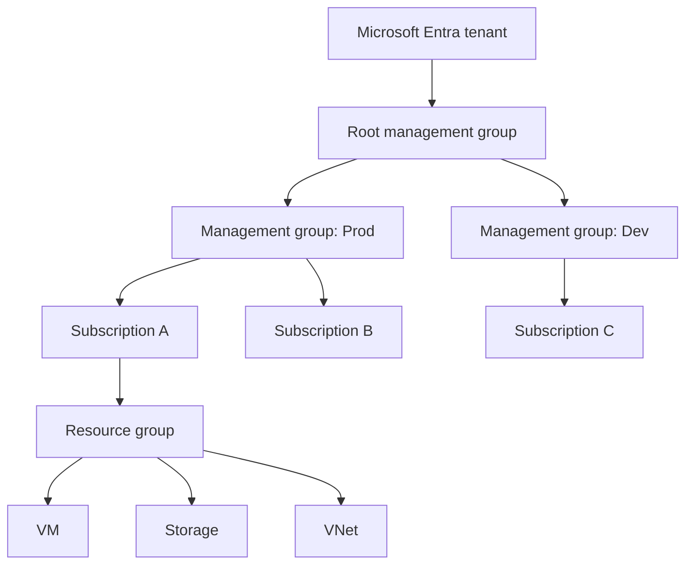
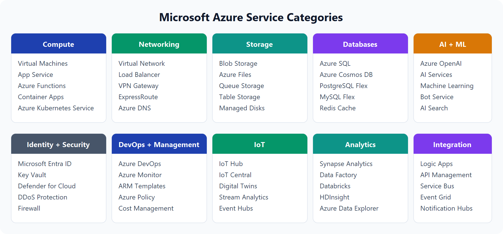
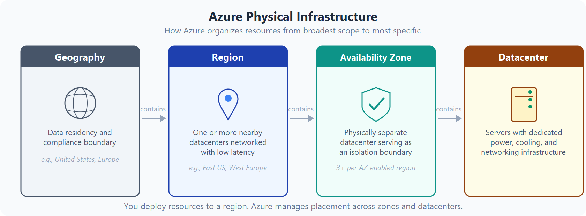
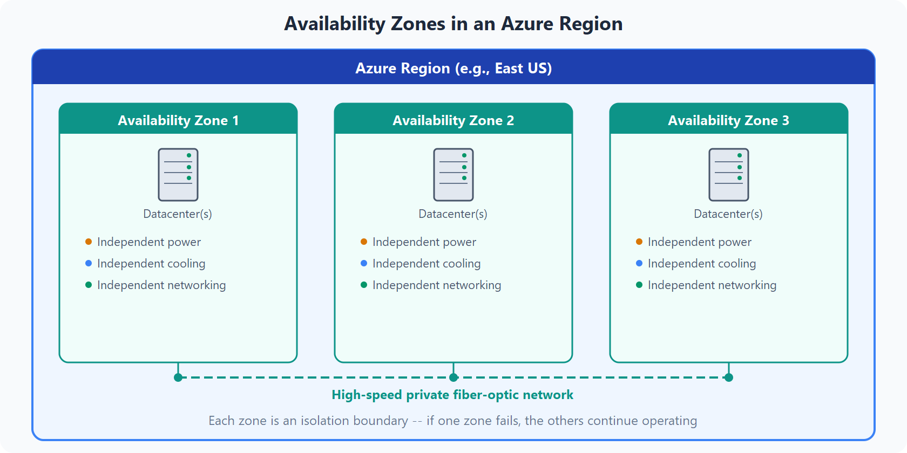
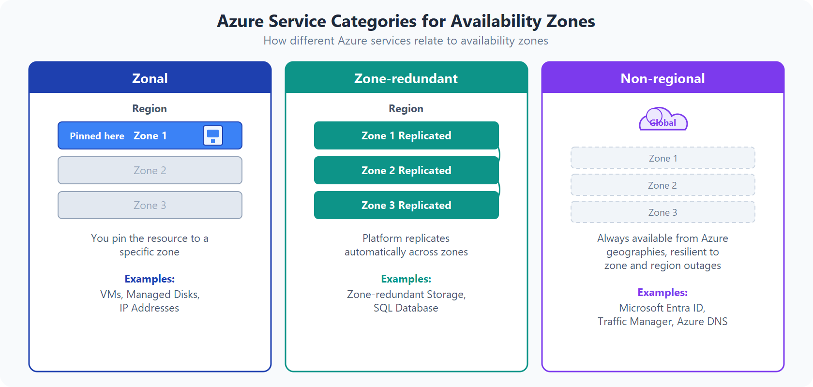
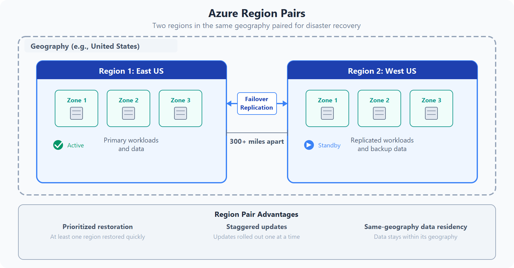
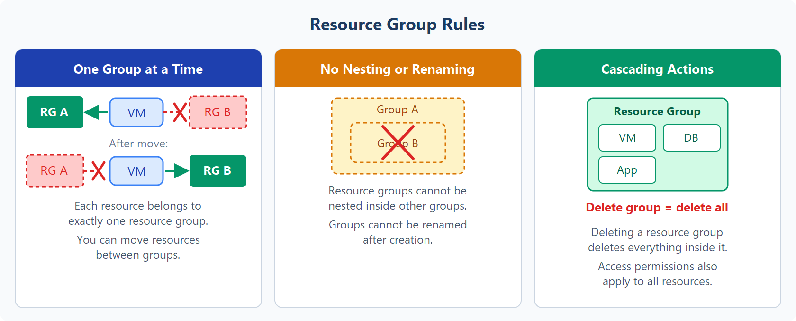
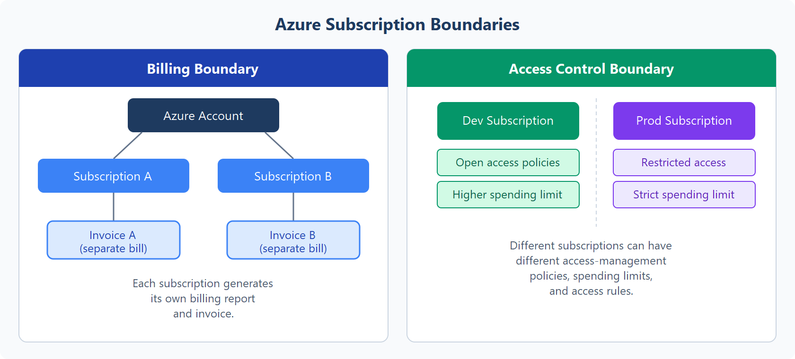
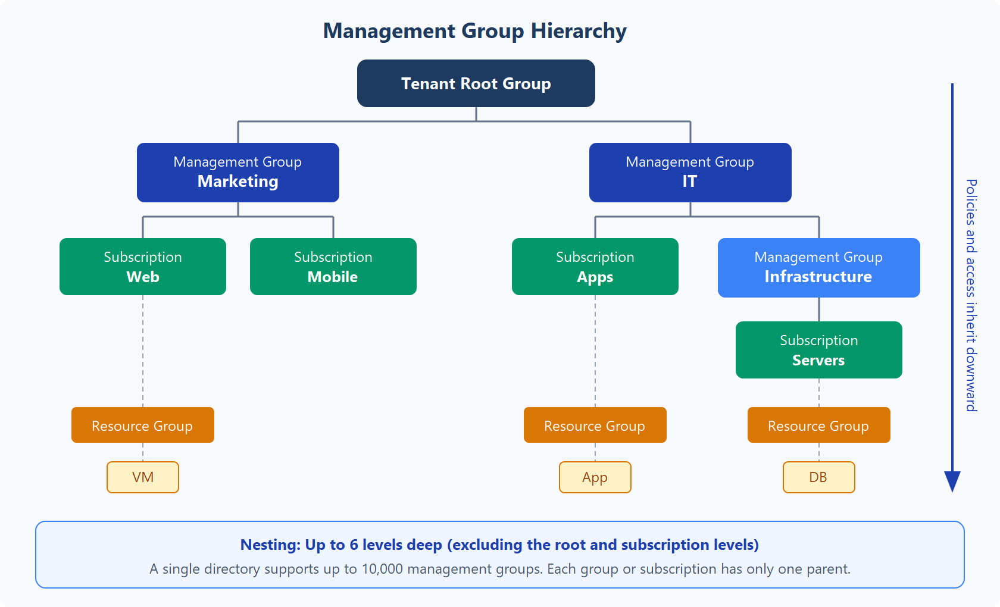

# Module 1: Describe the core architectural components of Azure
Units: Introduction · What is Microsoft Azure · Get started with Azure accounts · Azure physical infrastructure · Azure management infrastructure · Assessment · Summary

## What is Microsoft Azure
- A continually expanding set of cloud services: compute, storage, networking, databases, AI, IoT, DevOps, security.
- Pay-as-you-go (OpEx), scales on demand, available worldwide.
- Service models: **IaaS** (you manage the OS and up, e.g. VMs) · **PaaS** (you manage the app and data, e.g. App Service) · **SaaS** (you manage only data and access, e.g. Microsoft 365).

*Diagram showing ten Azure service categories: Compute, Networking, Storage, Databases, AI + ML, Identity + Security, DevOps + Management, IoT, Analytics, and Integration, each with representative services.*

## Azure accounts
- An **Azure account** gives you access to **one or more subscriptions**.
- Options: Free account (12 months of popular free services + credit for 30 days), Azure free student account, Microsoft Learn sandbox.
- Account → Subscriptions → Resource groups → Resources.

*Diagram showing four Azure account scope levels: an Azure Account at the top connects to three subscriptions (Dev/Test, Production, Sandbox), each containing resource groups (Web, Data, App, Network) that hold individual resources such as App Service, VM, SQL DB, Cosmos DB, Functions, API, VNet, and NSG.*

## Physical infrastructure
| Concept | Meaning | Exam tip |
|---|---|---|
| **Datacenter** | Physical building with racks, power, cooling, networking | You never pick a datacenter directly |
| **Region** | Geographical area with 1+ datacenters on a low-latency network | Some services are region-specific; some are global (Entra ID, Traffic Manager, DNS) |
| **Availability zone (AZ)** | Physically separate datacenter(s) within a region with independent power, cooling, network. Minimum 3 zones in AZ-enabled regions | Protects against **datacenter failure**. Zonal (pinned to one zone) vs zone-redundant (spread automatically) |
| **Region pair** | Two regions in the same geography, ≥300 miles apart where possible | Planned updates roll out to one region of the pair at a time; on a broad outage one region of every pair is prioritised for recovery; data stays in the same geography (except Brazil South) |
| **Sovereign regions** | Isolated instances: Azure Government (US), Azure operated by 21Vianet (China) | For compliance and legal requirements |

> Some newer regions have no pair. Use availability zones plus your own cross-region design for them.

*Diagram showing Azure's physical infrastructure hierarchy from Geography to Region to Availability Zone to Datacenter.*

*Diagram showing three physically separate availability zones within an Azure region, each with independent power, cooling, and networking, connected by fiber-optic links.*

*Diagram comparing three Azure availability zone service categories: Zonal, Zone-redundant, and Non-regional.*

*Diagram showing two paired Azure regions within a geography, each containing availability zones, with bidirectional failover replication and region pair advantages.*

## Management infrastructure
- **Resource**: a single manageable item (VM, VNet, DB).
- **Resource group (RG)**: logical container. A resource belongs to exactly **one** RG. RGs **cannot be nested**. Deleting an RG deletes everything in it. RBAC and policy applied to an RG are inherited by its resources. You can move resources between RGs.
- **Subscription**: a unit of **billing** and of **access control/scale limits**. Boundaries:
  - *Billing boundary*: separate invoices and cost reports per subscription.
  - *Access control boundary*: different access policies per subscription.
  - Reasons for extra subscriptions: environments (dev/test/prod), organisational structure, billing, and subscription limits.
- **Management group**: a container for subscriptions (and other management groups). Policy and RBAC are inherited downward.
  - Up to **10,000** management groups per directory.
  - Up to **6 levels of depth** (excluding the root and subscription level).
  - Each management group or subscription has exactly **one parent**.

*Diagram showing three resource group rules: a resource belongs to one group at a time (with move option), groups cannot be nested or renamed, and deleting a group deletes all resources inside it.*

*Diagram showing two subscription boundary types: billing boundary where each subscription generates a separate invoice, and access control boundary where dev and prod subscriptions have different access policies and spending limits.*

*Diagram showing a management group hierarchy from Tenant Root Group down through management groups (Marketing, IT) to subscriptions (Web, Mobile, Apps, Servers), resource groups, and individual resources, with policies and access inheriting downward.*

## Self-check
1. Which construct protects against the failure of a single datacenter in a region? → **Availability zones**
2. Can a resource group contain another resource group? → **No**
3. You need one policy applied to 40 subscriptions. Where do you assign it? → **A management group above them**
4. What happens to the resources when you delete a resource group? → **They are all deleted**
