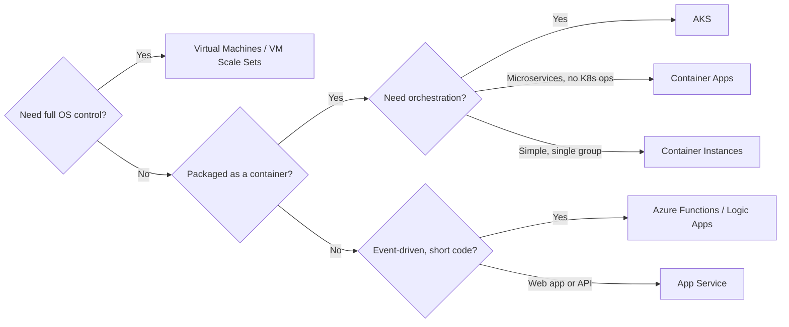
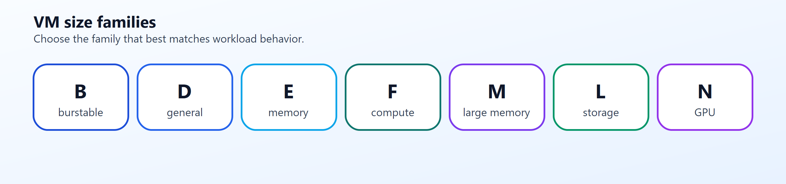
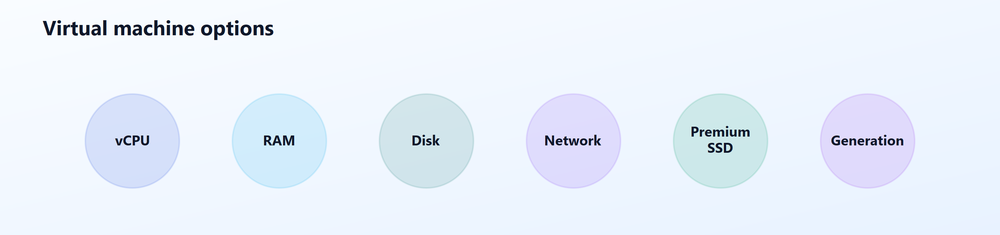
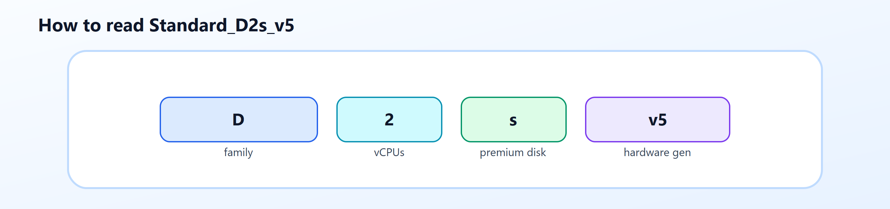
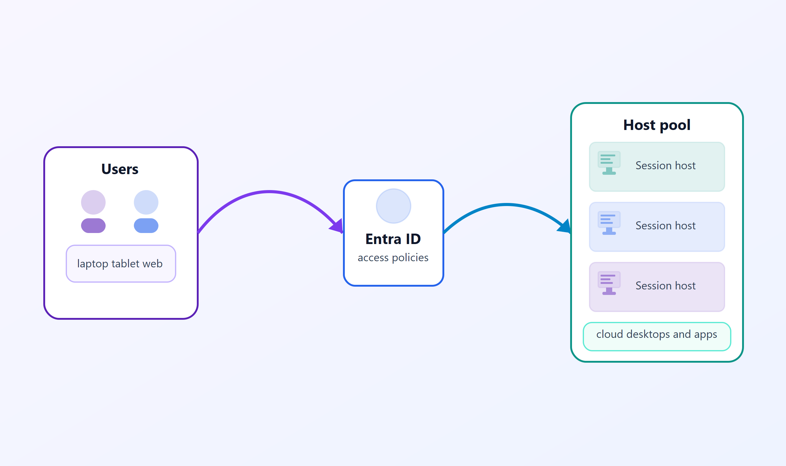
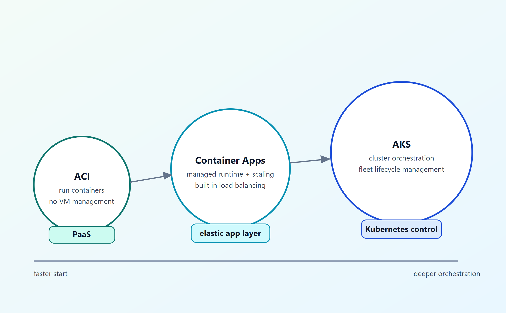
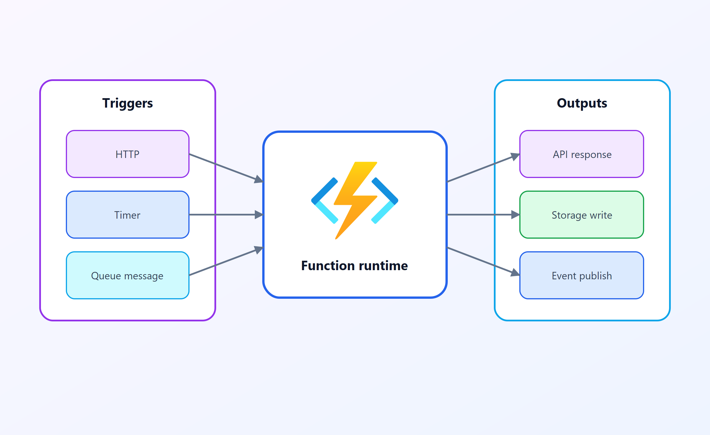
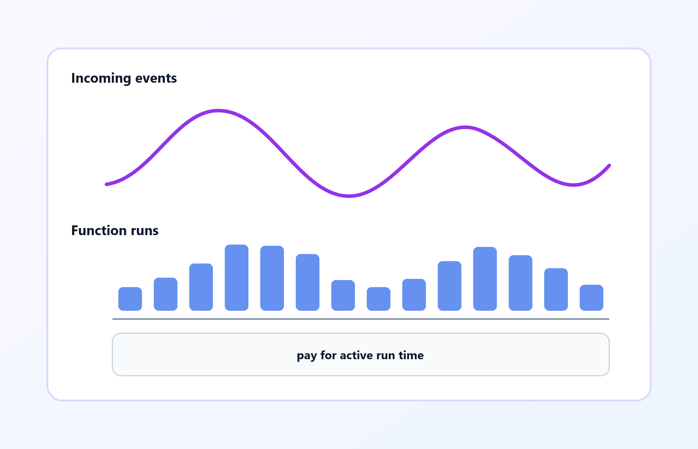
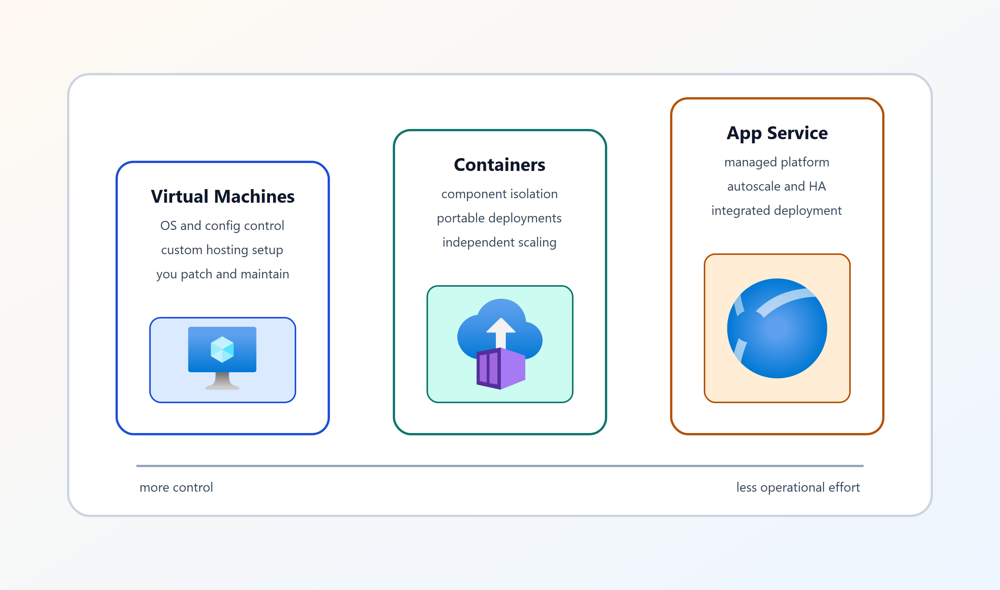

# Module 2: Describe Azure compute services
Units: Introduction · Virtual machines · Azure Virtual Desktop · Containers · Functions · AI, ML and IoT/Edge services · Application hosting options · Assessment · Summary

## Virtual machines (IaaS)
- Full control of the OS. Use for: lift-and-shift, testing, custom software, running apps in the cloud with full control.
- **VM Scale Sets (VMSS)**: identical, load-balanced VMs that **autoscale** automatically.
- **Availability sets**: protect against rack and host failure inside one datacenter.
  - **Fault domains** (up to 3): separate power and network.
  - **Update domains** (up to 20, default 5): groups rebooted together during planned maintenance.
  - No extra cost; you pay only for the VMs.
- VM resources: size (CPU/RAM), disks (OS + data), networking (VNet, public IP, ports).

*Diagram depicting Azure VM families.*

*Key VM sizing dimensions: vCPU, RAM, Disk, Network, Premium SSD support, and hardware generation.*

*Breakdown of Standard_D2s_v5 showing D as family, 2 as vCPU count, s as premium disk support, and v5 as hardware generation.*

## Azure Virtual Desktop (AVD)
- Desktop and app virtualisation that runs in the cloud. Centralised security with Entra ID and MFA; data is not stored on the user's device.
- **Windows 10/11 Enterprise multi-session**: several users share one VM, which lowers cost.

*Diagram showing users connecting through Microsoft Entra ID to a host pool.*

## Containers
| Service | When to use |
|---|---|
| **Azure Container Instances (ACI)** | Fastest and simplest: one container or group, no VM management, PaaS |
| **Azure Container Apps** | Serverless microservices, autoscale including to zero (KEDA), Dapr, ingress |
| **Azure Kubernetes Service (AKS)** | Full Kubernetes orchestration of many containers; managed control plane |
| **Azure Container Registry (ACR)** | Private registry to store images |

Containers vs VMs: a VM virtualises hardware; a container virtualises the OS, so it is lighter and starts faster.

*Diagram showing Azure containers arranged from faster start on the left to deeper orchestration on the right.*

## Azure Functions (serverless)
- Event-driven code (HTTP, timer, queue, blob…). Scales automatically; on the Consumption plan you pay only per execution.
- **Stateless** by default; **Durable Functions** add state and orchestration.

*Diagram showing event triggers activating the function runtime, which routes results to outputs like APIs, storage, and events.*

*Diagram showing serverless runs scale with events and bill only while running.*

## AI, ML and IoT/Edge (awareness level)
- **Azure AI services / Azure OpenAI**: prebuilt vision, speech, language and generative AI.
- **Azure Machine Learning**: train, deploy and manage ML models.
- **IoT Hub**: two-way device messaging. **IoT Central**: SaaS IoT app. **Azure IoT Edge / Azure Arc**: run workloads at the edge and on premises.

## Application hosting options
| Option | Notes |
|---|---|
| **Azure App Service** (PaaS) | Web apps, API apps, WebJobs (background jobs), mobile back ends. Windows/Linux, .NET, Java, Node, Python, PHP, Ruby. Autoscale, deployment slots, built-in CI/CD |
| Containers | ACI / Container Apps / AKS |
| VMs | When you need full control |

*Diagram showing hosting spectrum from VMs with more control, to containers, to App Service with less operational effort.*

## Self-check
1. Run hundreds of identical VMs that grow with load → **VM Scale Sets**
2. Code that runs only when a message lands in a queue and costs nothing while idle → **Azure Functions (Consumption plan)**
3. Kubernetes orchestration with a managed control plane → **AKS**
4. Protect VMs from one rack failing inside a datacenter → **Availability set (fault domains)**
