# Module 3: Describe Azure storage services
Units: Introduction · Storage accounts · Storage redundancy · Storage services · Data migration options · File movement options · Assessment · Summary

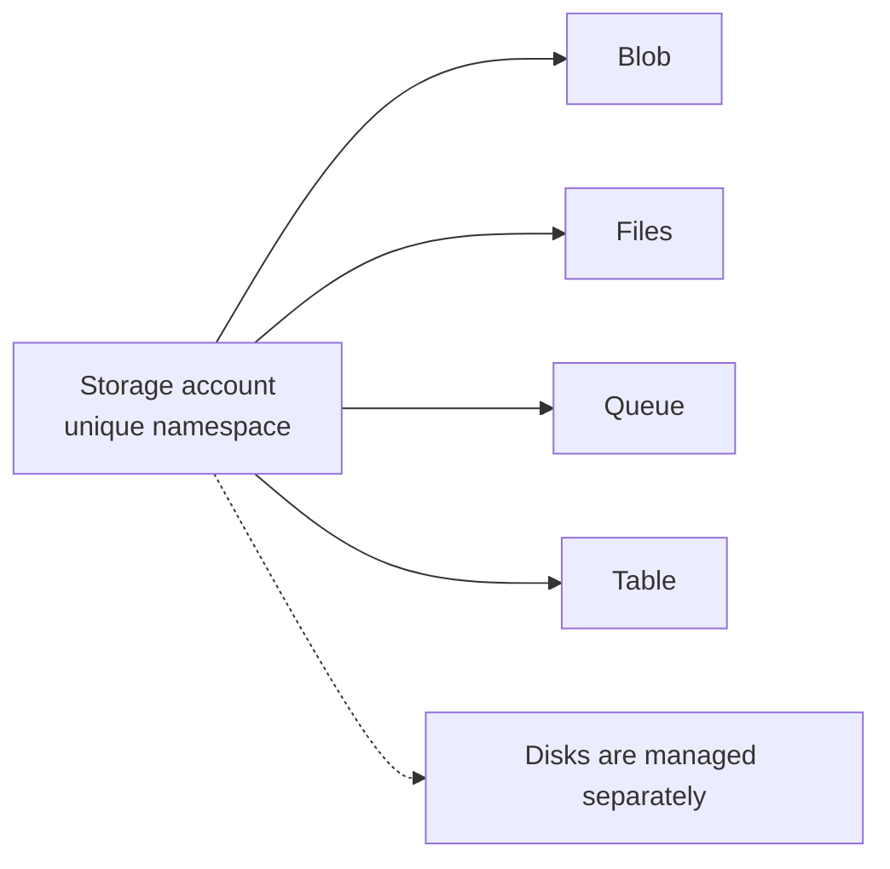

## Storage accounts
- A unique namespace: `https://<account>.blob.core.windows.net` (blob), `.file.`, `.queue.`, `.table.`, `.dfs.` (Data Lake Gen2).
- Name: 3–24 characters, lowercase letters and numbers, **globally unique**.

| Account type | Supports | Redundancy |
|---|---|---|
| **Standard general-purpose v2** | Blob (incl. Data Lake), Queue, Table, Files | LRS, GRS, RA-GRS, ZRS, GZRS, RA-GZRS |
| **Premium block blobs** | Block/append blobs, low latency | LRS, ZRS |
| **Premium file shares** | Files (SMB + NFS) | LRS, ZRS |
| **Premium page blobs** | Page blobs only | LRS, ZRS |

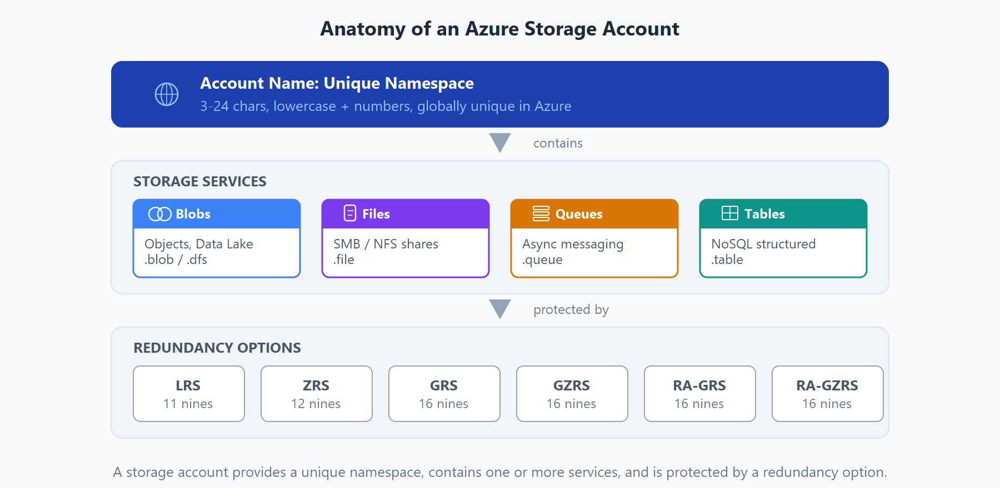
*Diagram showing the layered anatomy of an Azure Storage Account, from the account namespace to its services and redundancy options.*

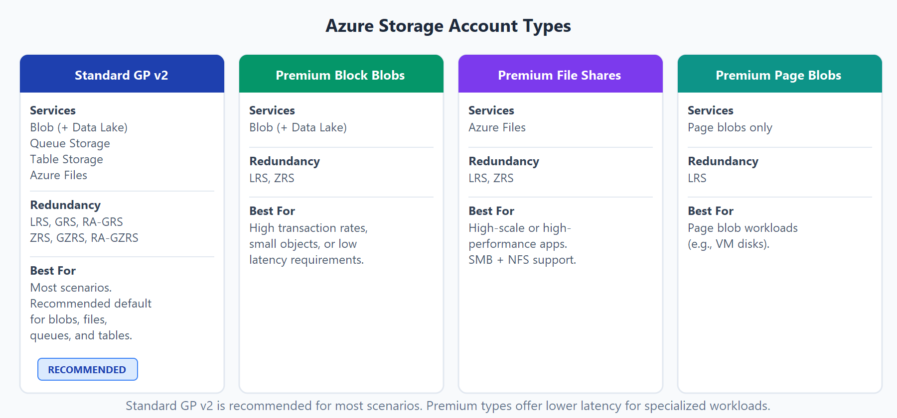
*Diagram comparing four Azure Storage account types: Standard general-purpose v2, Premium block blobs, Premium file shares, and Premium page blobs.*

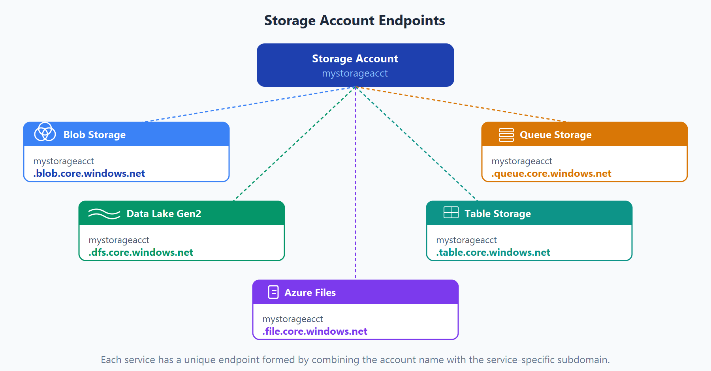
*Diagram showing five Azure Storage service endpoints branching from a central storage account, each with its unique subdomain URL.*

## Redundancy (very frequently tested)
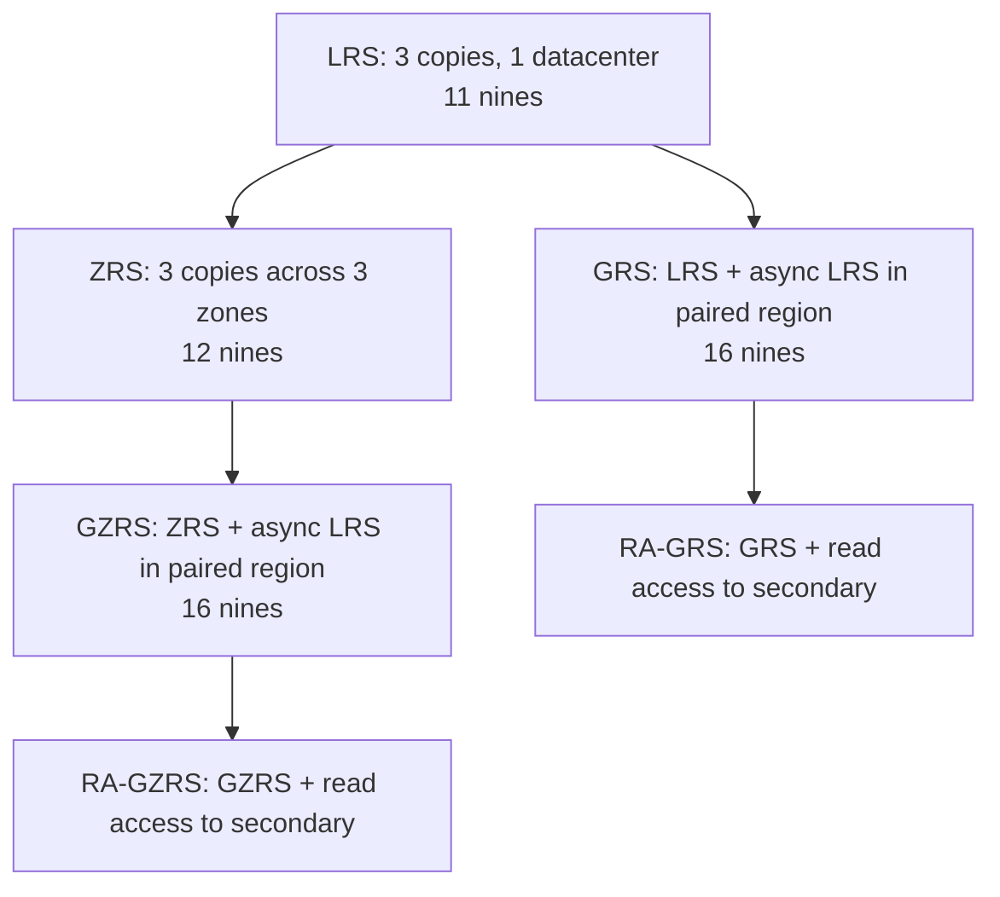
- Primary region: **LRS** (survives a disk/rack failure) or **ZRS** (survives a datacenter/zone failure).
- Secondary region: **GRS/GZRS**. The secondary is **not readable** unless you choose **RA-** (read-access). After a failover the secondary becomes primary.
- Asynchronous replication means RPO is usually **< 15 minutes**.

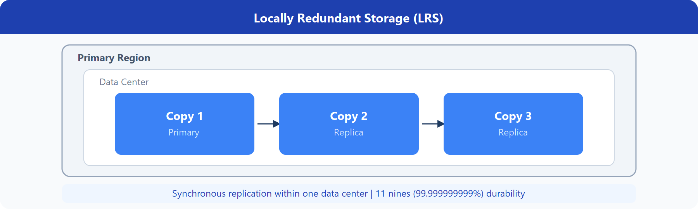
*Diagram showing the structure used for locally redundant storage.*

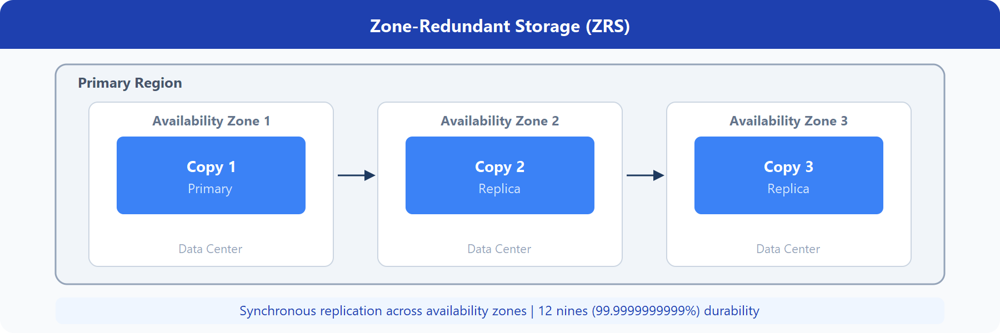
*Diagram showing ZRS, with a copy of data stored in each of three availability zones.*

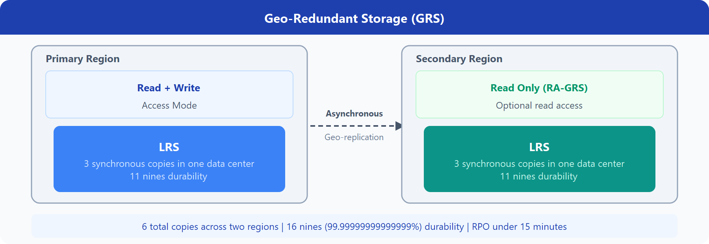
*Diagram showing GRS, with primary region LRS replicating data to LRS in a second region.*

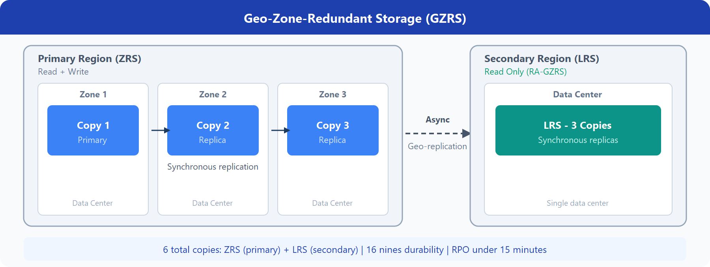
*Diagram showing GZRS, with primary region ZRS replicating data to LRS in a second region.*

## Storage services
| Service | Use |
|---|---|
| **Blob** | Unstructured objects: images, video, backups, logs, data lake. Access via HTTP/REST |
| **Azure Files** | Managed file shares over **SMB/NFS**, mount on Windows/Linux/macOS; Azure File Sync caches them on Windows Server |
| **Queue** | Messages up to 64 KB, millions of messages, async work between components |
| **Table** | NoSQL key/attribute store, schemaless |
| **Disks** | Block storage for VMs (managed disks) |

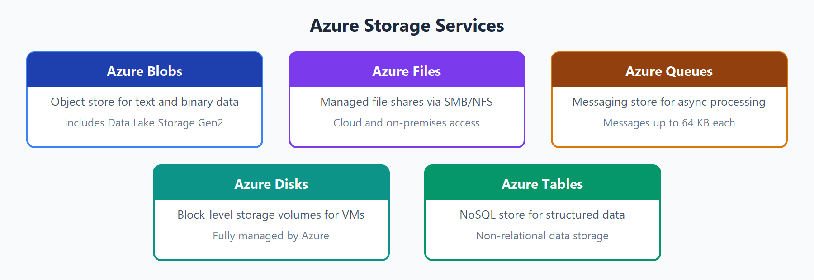
*Diagram showing five Azure Storage services: Azure Blobs, Azure Files, Azure Queues, Azure Disks, and Azure Tables with brief descriptions of each.*

### Blob access tiers
| Tier | Use | Minimum retention |
|---|---|---|
| **Hot** | Frequently accessed | — |
| **Cool** | Infrequent access | 30 days |
| **Cold** | Rarely accessed, fast retrieval | 90 days |
| **Archive** | Offline; rehydration takes **hours** | 180 days |
- Only Hot, Cool and Cold can be set at **account level**; Archive is set **per blob**. Use **lifecycle management** policies to move blobs between tiers automatically.

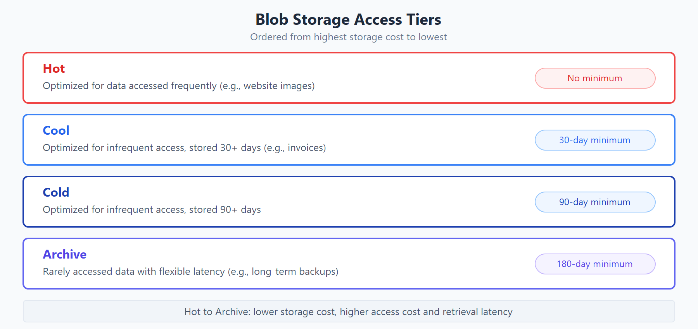
*Diagram showing four Blob Storage access tiers from Hot to Archive, with increasing minimum retention periods and decreasing storage costs.*

## Data migration options
- **Azure Migrate**: the hub to discover, assess and migrate servers, databases, web apps and VDI.
- **Azure Data Box** family: physical devices for **offline** transfer (up to ~80 TB usable per Data Box) when bandwidth is limited, in either direction (import or export).

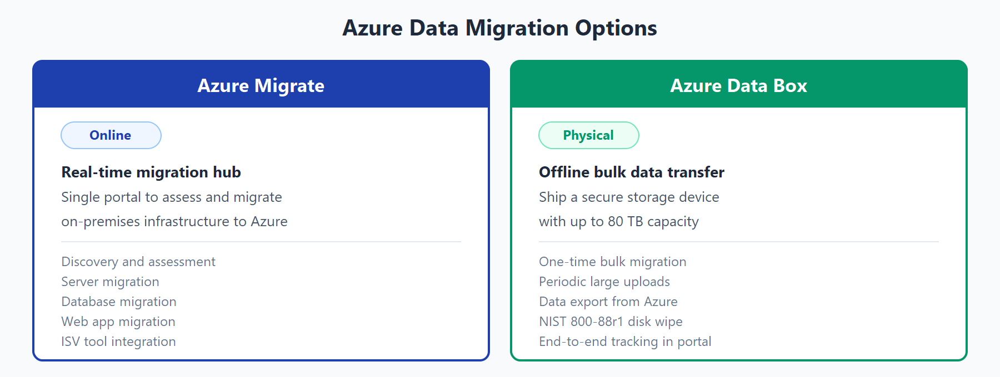
*Diagram comparing two Azure data migration approaches: Azure Migrate for online real-time migration and Azure Data Box for physical offline bulk data transfer.*

## File movement options
| Tool | Use |
|---|---|
| **AzCopy** | Command line copy/sync of blobs and files (one direction only for sync) |
| **Azure Storage Explorer** | GUI that uses AzCopy underneath |
| **Azure File Sync** | Syncs Windows file servers with Azure Files, with **cloud tiering** (keeps hot files locally) |

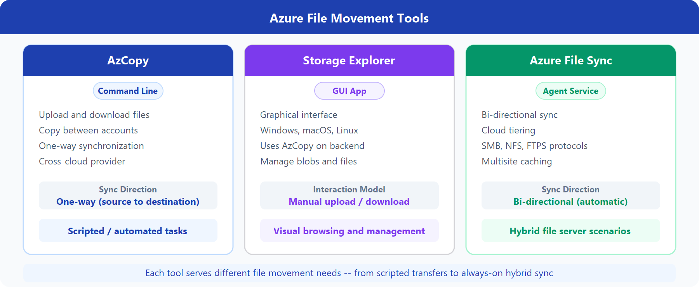
*Diagram comparing three Azure file movement tools: AzCopy for command-line scripted tasks, Storage Explorer for visual GUI management, and Azure File Sync for bi-directional hybrid sync.*

## Self-check
1. Survive the loss of a region **and** read data during the outage → **RA-GRS or RA-GZRS**
2. Survive a zone failure with data in a single region → **ZRS**
3. Move 200 TB with a slow internet link → **Azure Data Box**
4. Keep frequently used files on an on-premises file server and the rest in Azure → **Azure File Sync with cloud tiering**
