# Module 4: Describe Azure identity, access, and security
Units: Introduction · Directory services · Authentication methods · External identities · Conditional Access · RBAC · Zero Trust · Defense-in-depth · Encryption and key management · Microsoft Defender for Cloud · Assessment · Summary

## Directory services
- **Microsoft Entra ID** (formerly Azure AD): cloud identity and access management. Provides authentication, SSO, application management, device management, and hybrid identity.
- **Microsoft Entra Connect**: syncs on-premises AD DS users to Entra ID.
- **Microsoft Entra Domain Services**: managed domain services (domain join, group policy, LDAP, Kerberos/NTLM) **without deploying domain controllers**. Good for lifting legacy apps that need Kerberos/LDAP. One-way sync from Entra ID.

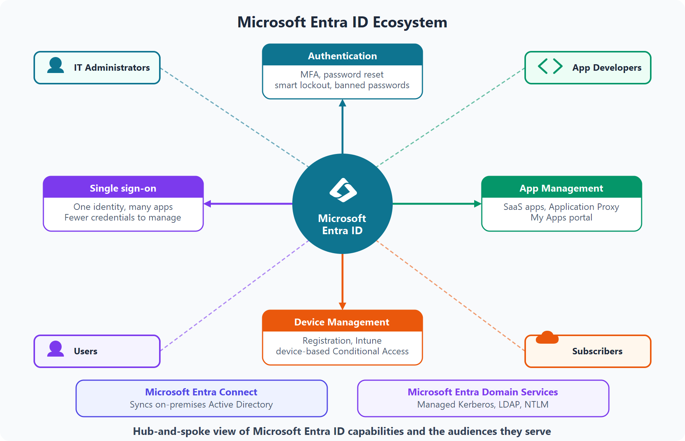
*Diagram showing Microsoft Entra ID at the center with spokes connecting to Authentication, Single sign-on, App Management, and Device Management capabilities.*

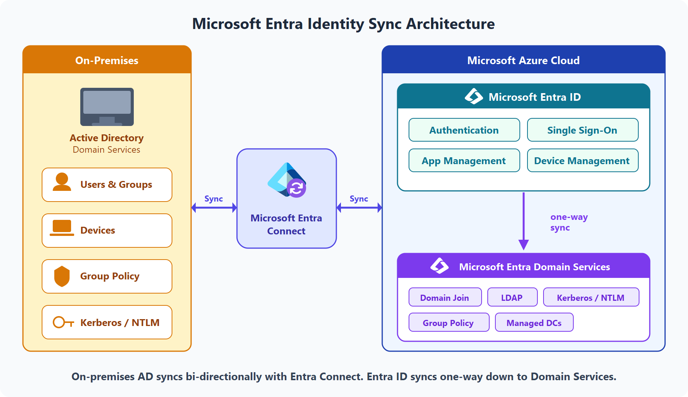
*Diagram showing the identity sync flow from on-premises Active Directory through Microsoft Entra Connect to Microsoft Entra ID and Domain Services.*

## Authentication methods
| Method | Notes |
|---|---|
| **Single sign-on (SSO)** | One identity for many apps |
| **MFA** | Something you know + something you have + something you are |
| **Passwordless** | Windows Hello for Business, Microsoft Authenticator, FIDO2 security keys, passkeys |

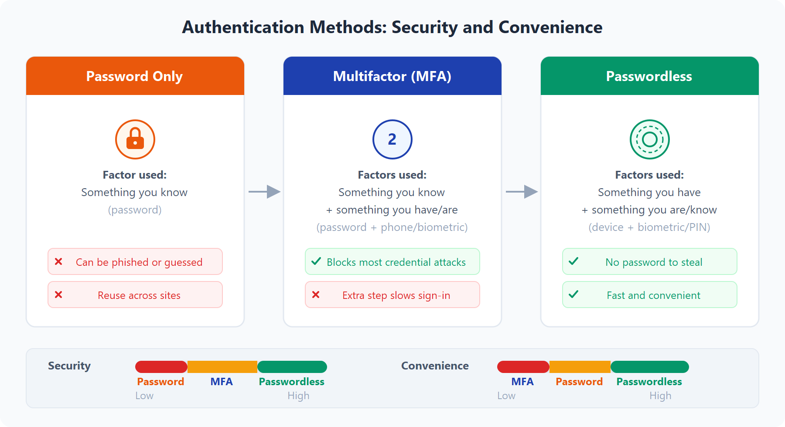
*Diagram comparing Password Only, Multifactor Authentication, and Passwordless methods across security and convenience. Passwordless scores highest on both scales.*

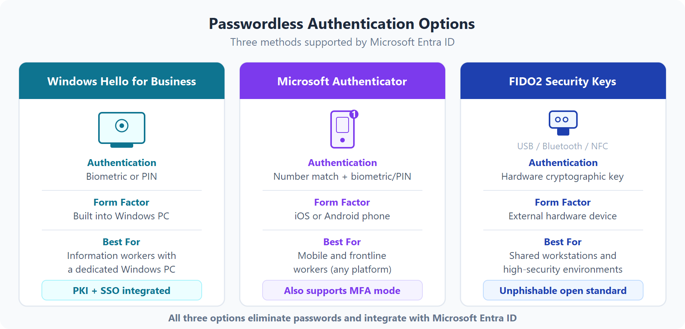
*Three-card comparison of Windows Hello for Business, Microsoft Authenticator, and FIDO2 Security Keys showing authentication type, form factor, and best-fit scenario for each.*

## External identities
- **B2B collaboration**: invite partners as guests; they sign in with their own credentials.
- **B2B direct connect**: mutual two-way trust with another Entra organisation (for example Teams shared channels).
- **Azure AD B2C / Microsoft Entra External ID**: customer-facing (CIAM) apps, social and local accounts.

*Diagram showing the three Microsoft Entra External ID capabilities: B2B Collaboration creates guest users in your directory, B2B Direct Connect uses mutual trust for Teams shared channels without directory presence, and External ID for Customers manages consumer access in a separate tenant.*

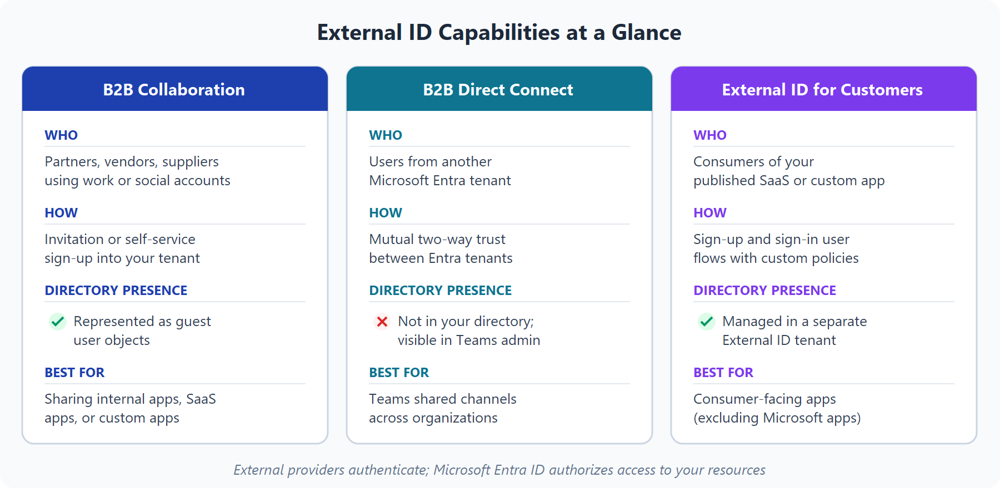
*Comparison cards for the three External ID capabilities showing who uses each, how access works, directory presence, and best-fit scenarios.*

## Conditional Access
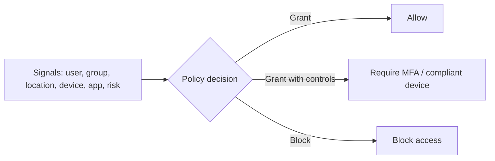
- If-then policies. Requires **Microsoft Entra ID P1** (risk-based policies need **P2**).

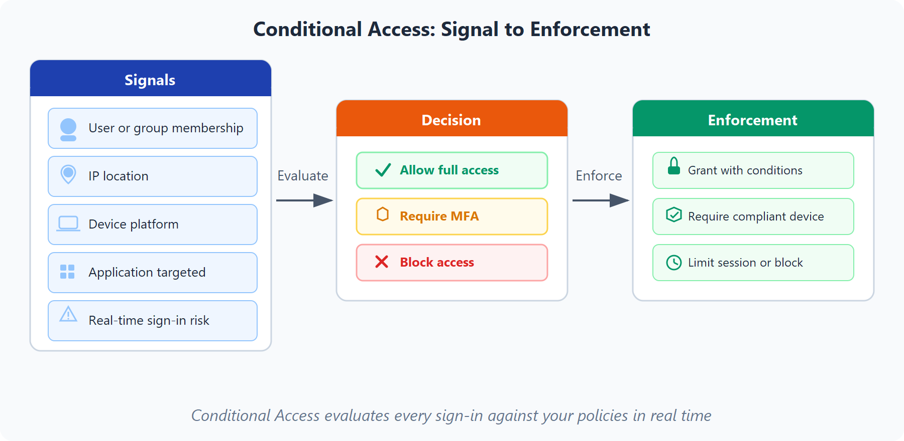
*Diagram showing the conditional access pipeline: signals such as user role, location, and device are evaluated, then enforced as allow, require MFA, or block.*

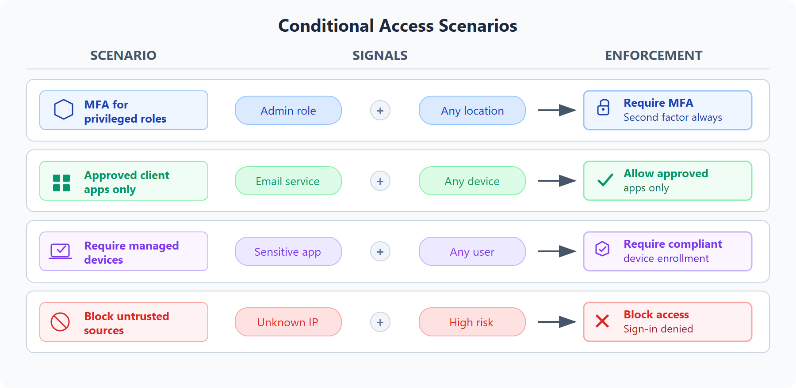
*Diagram showing four conditional access scenarios: MFA for privileged roles, approved client apps only, require managed devices, and block untrusted sources, each with their signals and enforcement actions.*

## Azure RBAC
- **Security principal** (user, group, service principal, managed identity) + **role definition** + **scope** = role assignment.
- Scopes: management group → subscription → resource group → resource. Assignments are **inherited** downward.
- Built-in roles: **Owner** (all, including access), **Contributor** (all except granting access), **Reader**, **User Access Administrator** (manage access only).
- RBAC is an **allow** model; Azure **deny assignments** exist (for example created by Blueprints/managed apps).

*A diagram showing Azure RBAC scope hierarchy from broadest to narrowest: Management Group, Subscription, Resource Group, and Resource. Each scope level shows example roles like Owner, Contributor, and Reader, with color-coded arrows indicating that permissions inherit downward from parent to child scopes.*

## Zero Trust
Three principles: **Verify explicitly**, **use least-privilege access**, **assume breach**. Never trust based on the network location.

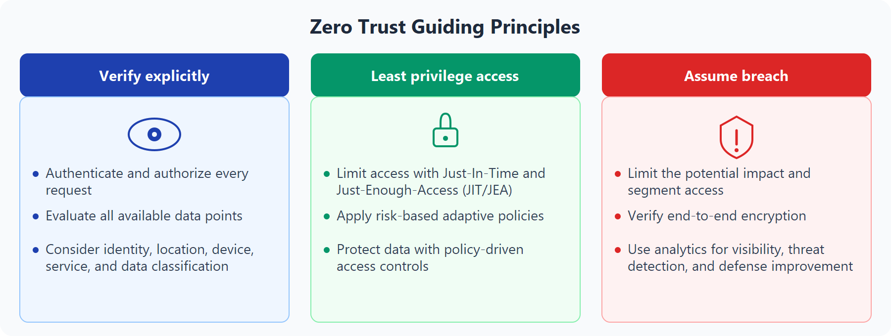
*Diagram showing the three Zero Trust guiding principles: Verify explicitly, Use least privilege access, and Assume breach, each with key actions listed.*

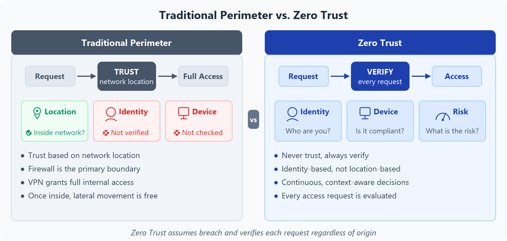
*Diagram comparing traditional perimeter security, which trusts based on network location, with Zero Trust, which verifies every request using identity, device, and risk signals.*

## Defense-in-depth (7 layers, outside → inside)
Physical security → Identity & access → Perimeter (DDoS, firewall) → Network (segmentation, NSG) → Compute (patching, endpoint protection) → Application (secure code, secrets) → **Data**.

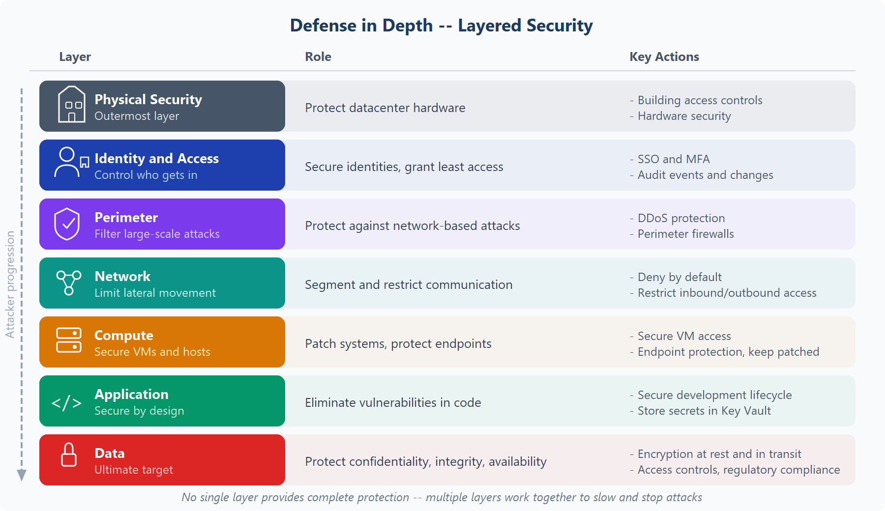
*Diagram showing seven defense-in-depth layers from Physical Security (outermost) to Data (innermost), each with its role and key actions listed.*

## Encryption and key management
- Encryption at rest is on by default (Storage Service Encryption, Transparent Data Encryption for SQL).
- Azure Disk Encryption (BitLocker/DM-Crypt) for VM disks.
- **Azure Key Vault**: store secrets, keys and certificates; HSM-backed options (Premium tier, Managed HSM).

## Microsoft Defender for Cloud
- **CSPM** (posture management): Secure Score and recommendations.
- **CWPP** (workload protection): Defender plans for servers, containers, SQL, storage, Key Vault and more.
- Covers Azure, on premises (via **Azure Arc**) and other clouds (AWS, GCP).
- Regulatory compliance dashboard (Microsoft cloud security benchmark, ISO, PCI…).

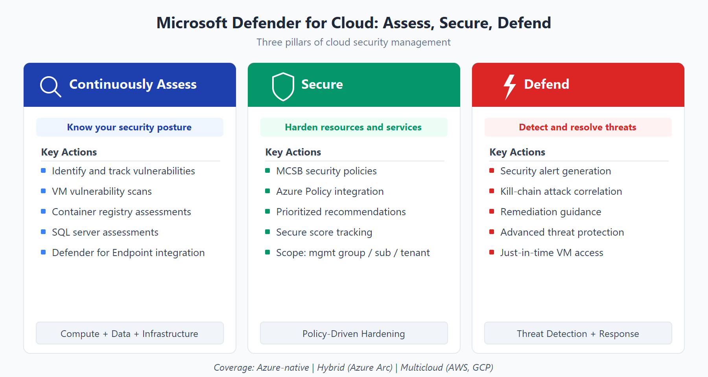
*Diagram showing three pillars of Defender for Cloud: Continuously Assess, Secure, and Defend.*

## Self-check
1. Legacy app needs LDAP/Kerberos but you do not want to manage DCs → **Microsoft Entra Domain Services**
2. Require MFA only when users sign in from outside the corporate network → **Conditional Access**
3. A user must manage resources but not grant access to others → **Contributor**
4. Which Zero Trust principle says "minimise blast radius"? → **Assume breach**
