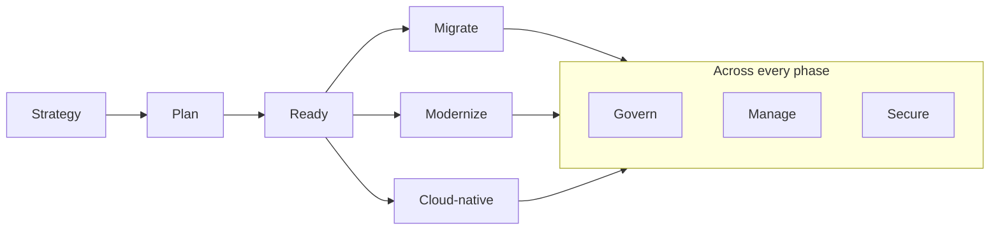

# Module 5: Introduction to the Microsoft Cloud Adoption Framework (CAF)
Units: Introduction · Strategy · Plan · Ready · Migrate · Modernize · Cloud-native · Govern · Manage · Secure · Assessment · Summary

CAF is Microsoft's proven guidance for the **whole cloud journey**: business, people and technology. WAF (module 6) improves individual **workloads**; CAF guides the **organisation**.

| Phase | What happens | Key outputs / tools |
|---|---|---|
| **Strategy** | Define business motivations, mission, outcomes, business case | Cloud strategy team, prioritised outcomes |
| **Plan** | Digital estate inventory, skills plan, adoption plan aligned to outcomes | Cloud adoption plan, **Azure Migrate** assessment, skills readiness |
| **Ready** | Prepare the environment | **Azure landing zones** (platform + application landing zones), subscription design, networking, identity |
| **Migrate** | Move workloads with minimal change (rehost) | Azure Migrate, Database Migration Service, the 5 Rs |
| **Modernize** | Improve existing workloads (replatform, refactor, rearchitect) | PaaS adoption, containers |
| **Cloud-native** | Build new workloads designed for the cloud | Microservices, serverless, AI |
| **Govern** | Policies, compliance, cost governance | **Azure Policy**, management groups, tags, Cost Management |
| **Manage** | Operations baseline, monitoring, BCDR | Azure Monitor, Azure Backup, Site Recovery |
| **Secure** | Security across the lifecycle, Zero Trust | Defender for Cloud, Microsoft Sentinel, Entra ID |

## Migration strategies (the "Rs")
| Strategy | Meaning |
|---|---|
| **Retire** | Turn off workloads no longer needed |
| **Rehost** | Lift-and-shift to IaaS VMs, no code change |
| **Replatform** | Move to a managed platform with minimal change (for example SQL Server → Azure SQL Managed Instance) |
| **Refactor** | Code changes to use PaaS or improve the code (for example App Service, Azure SQL) |
| **Rearchitect** | Change the architecture (for example to microservices) |
| **Rebuild** | Rewrite cloud-native |
| **Replace** | Swap for SaaS |

## Azure landing zones
- A pre-configured environment built from **design areas**: billing & tenant, identity & access, resource organisation, network topology, security, management, governance, platform automation & DevOps.
- **Platform landing zone**: shared services (identity, connectivity hub, management).
- **Application landing zone**: subscriptions for workloads.

## Self-check
1. Which phase creates the landing zone? → **Ready**
2. Which phase sets up Azure Policy and cost controls? → **Govern**
3. Move a VM unchanged to Azure → **Rehost**
4. Which framework focuses on a single workload's quality? → **Well-Architected Framework**
