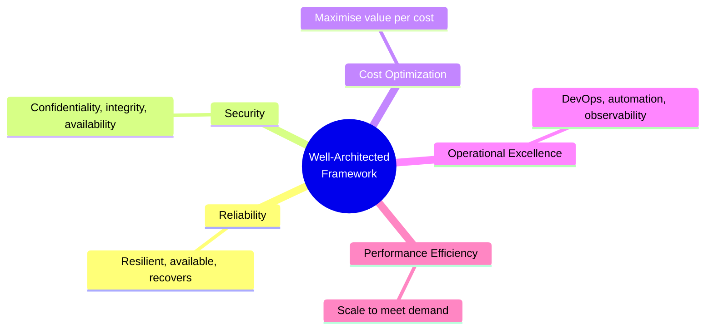

# Module 6: Introduction to the Microsoft Azure Well-Architected Framework (WAF)
Units: Introduction · Azure Well-Architected Framework pillars · Summary

The WAF is a set of guiding tenets for improving the quality of a **workload**. Each pillar has design principles, checklists, trade-offs, and recommendations. The full deep dive is in [folder 06](../06-Well-Architected-Framework).

| Pillar | Goal | Example design choices |
|---|---|---|
| **Reliability** | The workload meets its uptime and recovery targets | Availability zones, multi-region, health probes, retries, backup |
| **Security** | Protect against threats (CIA triad) | Zero Trust, Entra ID, managed identities, encryption, Key Vault, WAF/Firewall |
| **Cost Optimization** | Deliver business value at the lowest cost | Right-sizing, reservations, autoscale, Spot VMs, budgets |
| **Operational Excellence** | Deploy and run reliably and safely | IaC, CI/CD, monitoring, safe deployment practices |
| **Performance Efficiency** | Adapt efficiently to changes in demand | Scale out, caching, CDN, partitioning, load testing |

## Tools
- **Azure Well-Architected Review**: an assessment questionnaire that scores your workload.
- **Azure Advisor**: personalised recommendations grouped by the same five pillars.
- **Azure Architecture Center**: reference architectures and patterns.

## Trade-offs
Pillars can conflict. Example: multi-region improves reliability but raises cost; more security inspection can add latency. Architects balance them against business requirements.

## Self-check
1. Which tool gives recommendations by WAF pillar for existing resources? → **Azure Advisor**
2. Autoscaling to meet peak demand belongs mainly to which pillar? → **Performance Efficiency**
3. Infrastructure as code and CI/CD belong mainly to? → **Operational Excellence**
