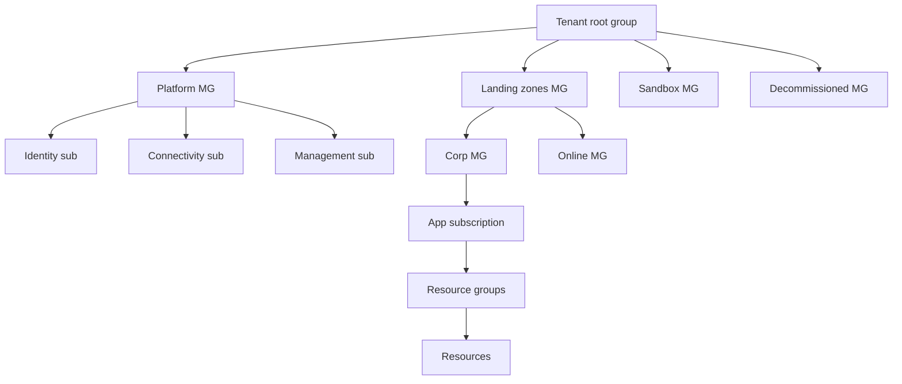

# Module 1: Design governance
Units: Introduction · Design for governance · Design for management groups · Design for subscriptions · Design for resource groups · Design for resource tags · Design for Azure Policy · Design for RBAC · Design for Azure landing zones · Knowledge check · Summary

Exam skills: recommend a structure for management groups, subscriptions, resource groups and tagging · recommend a compliance solution · recommend an identity governance solution.

Policy and RBAC flow **down** this tree. Assign as **high** as possible, as **narrow** as needed.

## Management groups
- Organise subscriptions by **governance requirements**, not by org chart. Keep the hierarchy shallow (3–4 levels recommended; the limit is 6).
- Apply policy at management group level (for example "allowed regions" for all of production).
- Root management group: don't assign directly to it unless needed; changes to it require elevated permissions.

## Subscriptions
- Use them as **units of management, billing and scale**. Reasons to split: different environments, cost centres, compliance boundaries, scale limits, network isolation.
- Create a **dedicated subscription for shared platform services** (identity, connectivity hub, management/logging).
- Subscription quotas are a hard limit: design for scale-out across subscriptions.

## Resource groups
- Put resources with the **same lifecycle** together (deploy, update and delete as one).
- An RG has a location (where its metadata is stored), but resources can be in other regions.
- Use RGs as a scope for RBAC and as a unit for deletion.

## Resource tags
- Name/value pairs for **cost reporting, ownership, environment, criticality**. Example: `CostCenter`, `Env`, `Owner`, `DataClassification`.
- Tags are **not inherited** by default → use **Azure Policy** (`Inherit a tag from the resource group`, `Require a tag`) to enforce them.
- Limit: 50 tags per resource.

## Azure Policy
- Evaluates resources for compliance with rules. Effects: **Deny**, **Audit**, **Append**, **Modify**, **DeployIfNotExists**, **AuditIfNotExists**, **Disabled**, (**DenyAction**, **Manual**).
- **Initiative** (policy set): a group of policies with one goal (for example ISO 27001, Microsoft cloud security benchmark).
- **Remediation tasks** fix existing non-compliant resources (for `Modify`/`DeployIfNotExists`).
- Policy applies to new and existing resources; existing ones are marked non-compliant, not deleted.

| Azure Policy | Azure RBAC |
|---|---|
| Controls **what** can be deployed (properties) | Controls **who** can do actions |
| Default allow, rules deny | Default deny, roles allow |

## Azure RBAC design
- Assign roles to **groups**, not individuals. Use **least privilege**.
- Use **custom roles** when built-in ones are too broad.
- Use **Privileged Identity Management (PIM)** for just-in-time elevation (Entra ID P2).

## Azure landing zones
- Use the CAF landing-zone architecture (shown in the diagram) as the reference.
- Start options: **Azure landing zone accelerator** (portal), Bicep/Terraform modules.
- Separate **platform** (identity, management, connectivity) from **application** landing zones.

## Compliance and identity governance
- **Microsoft Defender for Cloud → Regulatory compliance** and **Azure Policy initiatives** → continuous compliance view.
- **Microsoft Purview**: data governance, data map and classification.
- **Resource locks**: `CanNotDelete` / `ReadOnly`, applied to subscriptions, RGs or resources; they override RBAC permissions.
- **Identity governance** (Entra ID P2 / Entra ID Governance): **access reviews**, **entitlement management** (access packages), **PIM**, lifecycle workflows.

## Exam tips
- "Prevent deployment of resources in non-approved regions" → **Azure Policy (Deny)** at management group.
- "Ensure every resource has a CostCenter tag copied from the RG" → **Policy with the Modify effect**.
- "Prevent accidental deletion" → **Resource lock (CanNotDelete)**.
- "Periodically confirm guests still need access" → **Access reviews**.
- "Give admins temporary elevated rights with approval" → **PIM**.
