# Module 2: Design authentication and authorization solutions
Units: Introduction · Identity and access management · Microsoft Entra ID · B2B · Azure AD B2C (External ID) · Conditional Access · Identity Protection · Access reviews · Service principals · Managed identities · Key Vault · Knowledge check · Summary

Exam skills: authentication solution · identity management · authorise access to Azure resources · authorise access to on-premises resources · manage secrets, certificates and keys.

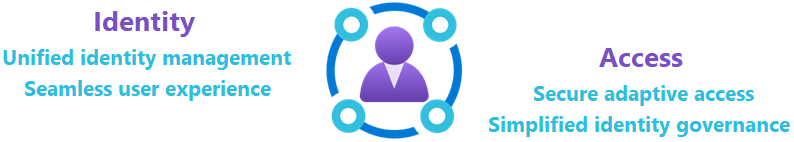
*Diagram of the four basic guidelines for a strong IAM solution.*

## Hybrid identity: choose the authentication method
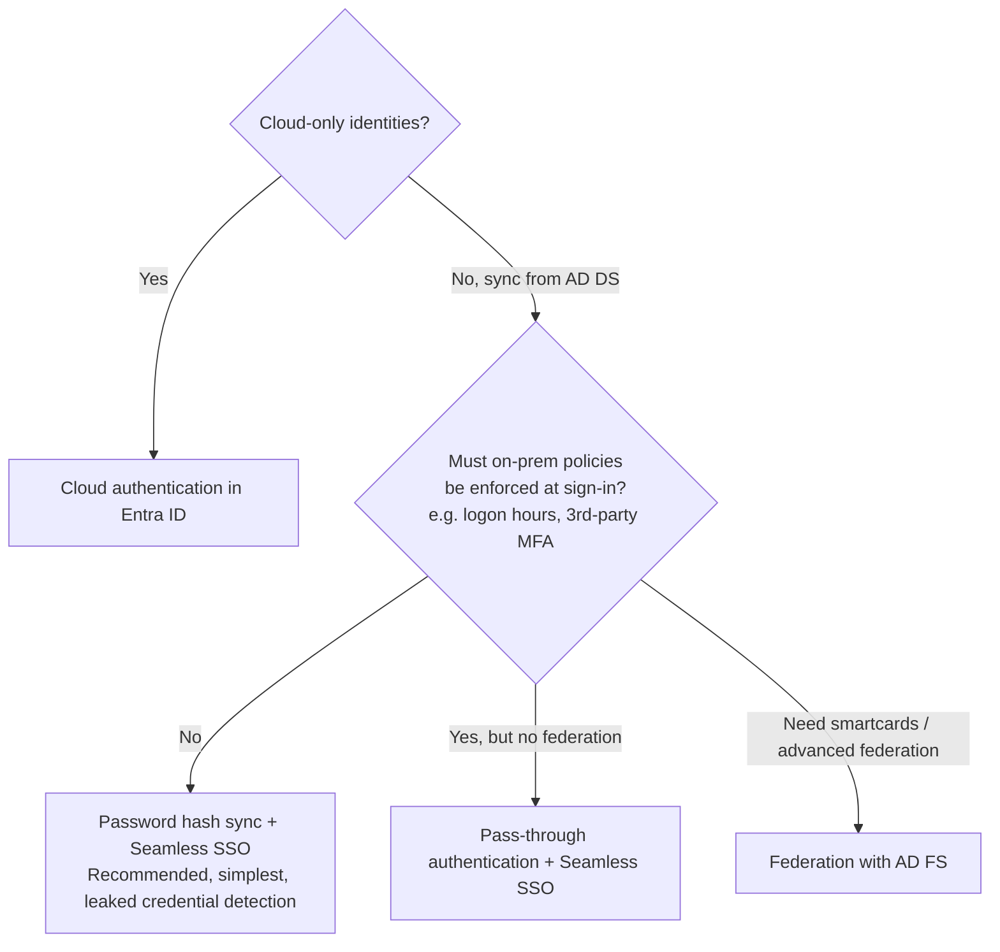
| Method | Key facts |
|---|---|
| **Password hash sync (PHS)** | Hash of hash synced; works even if on-prem is down; enables **leaked credentials** detection. Microsoft's recommendation |
| **Pass-through auth (PTA)** | Password validated on premises by agents; on-prem down = no sign-in (enable PHS as backup) |
| **Federation (AD FS)** | Most complex; needed for smartcard/certificate sign-in or 3rd-party federation |
- Sync tools: **Microsoft Entra Connect Sync** (on-prem server) or **Microsoft Entra Cloud Sync** (lightweight agents, multi-forest friendly).

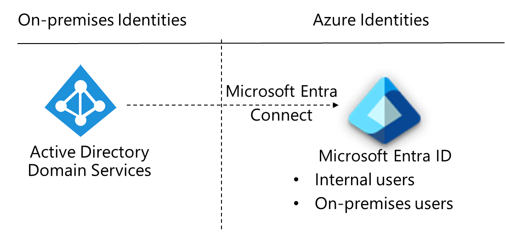
*Diagram that shows how Microsoft Entra Connect syncs Active Directory Domain Services and Microsoft Entra ID.*

## Microsoft Entra ID editions
| Edition | Adds |
|---|---|
| Free | Users, groups, basic SSO, MFA via security defaults |
| **P1** | **Conditional Access**, dynamic groups, hybrid features, self-service password reset with writeback, App Proxy |
| **P2** | **Identity Protection** (risk-based), **PIM**, **access reviews** |

## External identities
- **B2B**: partner employees use their own identity as **guests** in your tenant. Govern with access reviews and entitlement management.
- **Azure AD B2C / Entra External ID**: **customer** identities for your public apps; social logins (Google, Facebook), custom branding, user flows/custom policies.

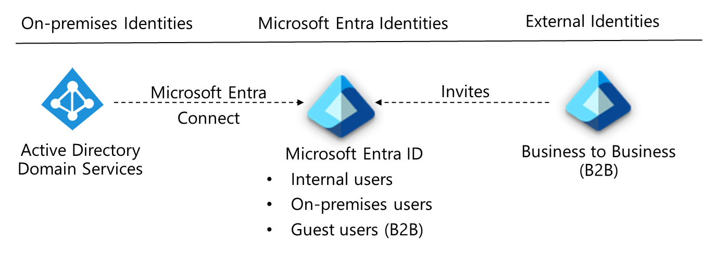
*Diagram that shows how business-to-business users are invited to Microsoft Entra ID.*

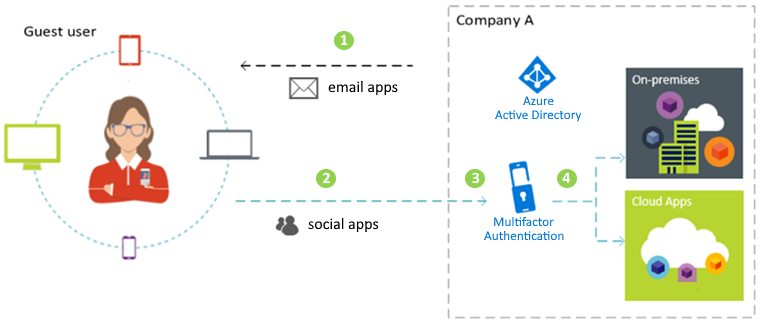
*Diagram that shows how guest users are invited to Microsoft Entra ID.*

## Conditional Access and Identity Protection
- Conditional Access = signals → decision → enforcement. Common policies: require MFA for admins, block legacy authentication, require compliant/hybrid-joined devices, block risky countries.
- **Identity Protection** (P2): **user risk** (leaked credentials) and **sign-in risk** (unfamiliar location, anonymous IP). Use it in risk-based Conditional Access (for example high user risk → force password change).

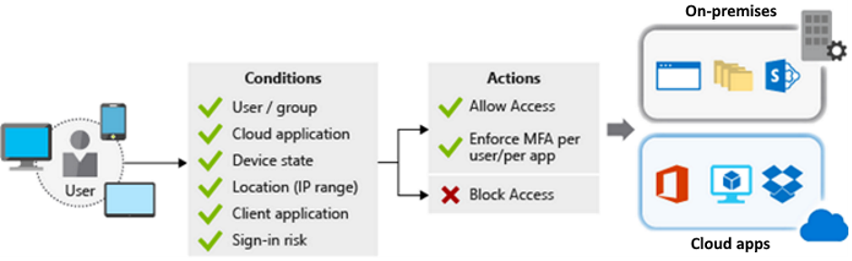
*Diagram that shows how the Conditional Access tool evaluates conditions and determines access.*

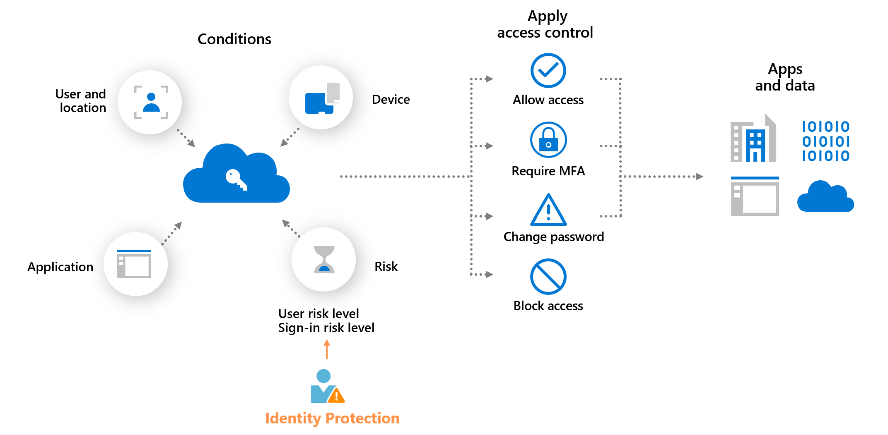
*Diagram that shows automated remediation.*

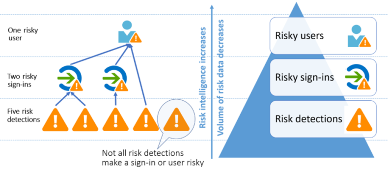
*Diagram that shows risky users, risky sign-ins, and risk detections.*

## Access reviews
- Periodic reviews of group membership, app access, and role assignments. Reviewers can be owners, managers, or self. Auto-apply results to remove access.

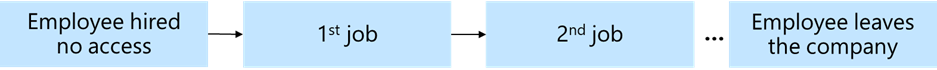
*Diagram that shows identity management for an employee from their hire date, to access for specific roles, to their access removed when they leave the company.*

## Authorise apps: service principals and managed identities
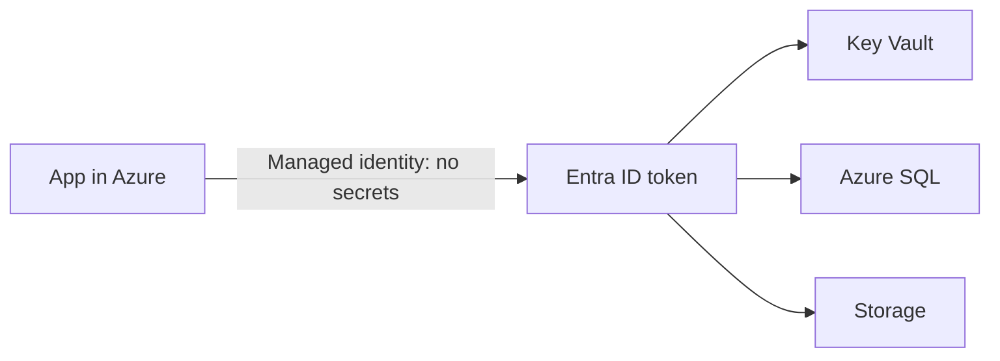
| Option | When |
|---|---|
| **App registration / service principal** | App identity; uses a secret or certificate (you manage rotation). Needed for apps outside Azure or multi-tenant apps |
| **System-assigned managed identity** | Tied to one resource's lifecycle; deleted with it |
| **User-assigned managed identity** | Standalone resource; **share across many resources**; survives resource deletion |
| **Workload identity federation** | GitHub Actions / Kubernetes / other clouds get tokens **without secrets** |
- Exam rule: "Azure resource must access another Azure service **without storing credentials**" → **managed identity**.

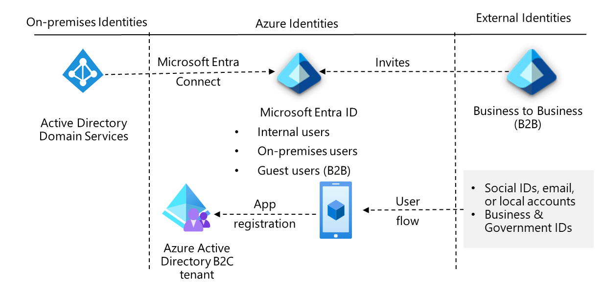
*Diagram that shows how business-to-customer users are registered in the Microsoft Entra tenant.*

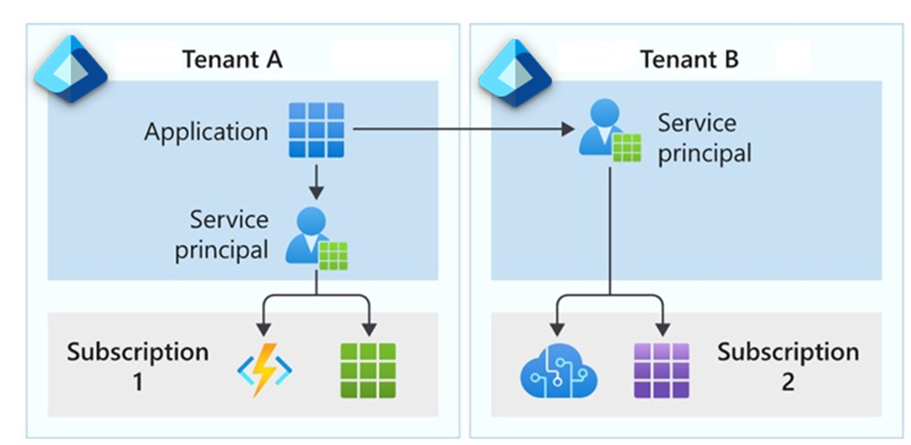
*Diagram that shows how application objects and service principals are used in Azure subscriptions.*

## Authorise access to on-premises resources
- **Microsoft Entra application proxy**: publish on-prem web apps to remote users with Entra pre-authentication, no inbound firewall ports (outbound connector). Supports Kerberos constrained delegation (KCD) for Integrated Windows Authentication apps.
- **Microsoft Entra Private Access** (Global Secure Access): ZTNA alternative to VPN for any TCP/UDP app.
- **Microsoft Entra Domain Services** for apps that need LDAP/Kerberos in Azure.

## Azure Key Vault
- Stores **secrets** (passwords, connection strings), **keys** (encryption keys, including HSM-protected) and **certificates** (with automatic renewal).
- Tiers: **Standard** (software keys), **Premium** (HSM-backed keys). **Managed HSM**: single-tenant FIPS 140-3 Level 3 HSM pool.
- Access model: **Azure RBAC** (recommended) or legacy access policies.
- Protection: **soft delete** (on by default, 7–90 days) + **purge protection** (required for CMK scenarios). Use **private endpoints** and firewall.
- Best practice: one vault **per application per environment per region**.
- Customer-managed keys (CMK) for Storage, SQL TDE, disks via Key Vault.

## Exam tips
- Want to keep signing in if on-prem AD is down → **PHS**.
- Enforce on-prem account policies at sign-in without AD FS → **PTA**.
- Customer sign-up with Google/Facebook → **Azure AD B2C / External ID**.
- Revoke access automatically when a review is not answered → **access review** with auto-apply.
- Remote users to on-prem web app without VPN → **Application Proxy**.
- Many VMs share one identity to read the same Key Vault → **user-assigned managed identity**.
