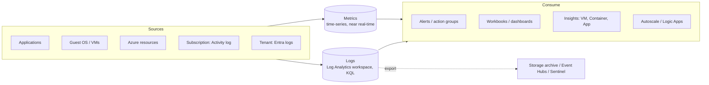
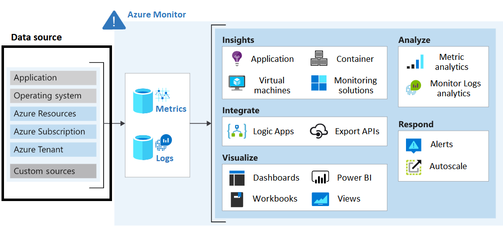
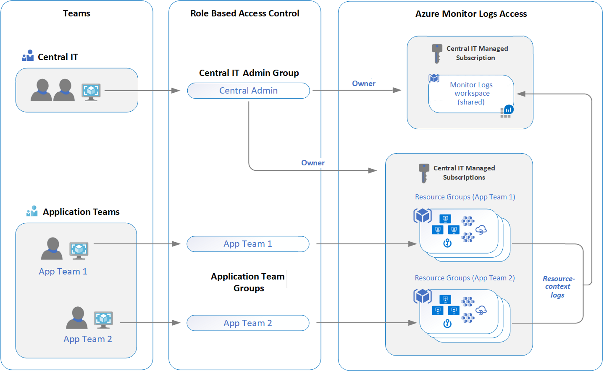
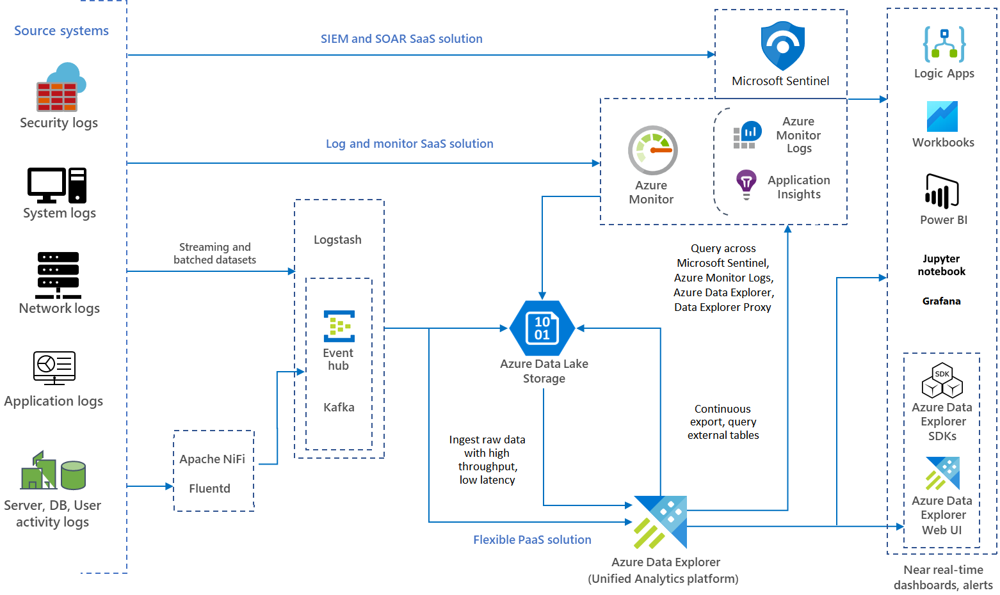

# Module 3: Design a solution to log and monitor Azure resources
Units: Introduction · Design for Azure Monitor data sources · Design for Log Analytics · Design for Azure Workbooks and Azure Insights · Design for Azure Data Explorer · Knowledge check · Summary

Exam skills: recommend a logging solution · recommend log routing · recommend a monitoring solution.

## Azure Monitor data sources (tiers)
| Source | Data | How collected |
|---|---|---|
| Application | Requests, dependencies, exceptions, traces | **Application Insights** (SDK / OpenTelemetry / auto-instrumentation) |
| Guest OS | Performance counters, event logs, syslog | **Azure Monitor Agent (AMA)** + **Data Collection Rules (DCR)** |
| Azure resources | **Platform metrics** (automatic), **resource logs** | Resource logs need a **diagnostic setting** |
| Subscription | **Activity log** (who did what, control plane) | Automatic; kept 90 days, route with diagnostic setting |
| Tenant | Entra ID sign-in and audit logs | Diagnostic setting in Entra ID |

*Diagram that shows sources of monitoring data for Azure Monitor.*

## Log routing (diagnostic settings destinations)
| Destination | Use |
|---|---|
| **Log Analytics workspace** | Query with KQL, alerts, workbooks, Sentinel |
| **Storage account** | Cheap **long-term archive / audit** retention |
| **Event Hubs** | Stream to **third-party SIEM** (Splunk, QRadar) or external tools |
| Partner solutions | Datadog, Elastic, etc. |

## Log Analytics workspace design
- Prefer **as few workspaces as possible** (one central workspace is simplest).
- Create more workspaces when you need: data **sovereignty/region** requirements, separate **billing**, different **retention**, or separate tenants (MSP, use Azure Lighthouse).
- Access modes: **workspace-context** vs **resource-context** (users see logs only for resources they have access to). Use **table-level RBAC** for fine control.
- Retention: interactive retention up to 2 years, total (long-term/archive) up to 12 years. Table plans: **Analytics**, **Basic** (cheap, limited queries), **Auxiliary**.
- Cost: **commitment tiers** for steady high ingestion.

*Diagram that shows how to design an Azure Monitor Logs deployment.*

## Visualise and analyse
| Tool | Use |
|---|---|
| **Azure Workbooks** | Interactive reports combining metrics, logs, parameters; templates |
| **Insights** (VM, Container, Network, Storage, Key Vault, Application) | Curated monitoring experience for a service |
| **Azure dashboards** | Pin tiles in the portal |
| **Azure Managed Grafana** | Grafana dashboards over Azure Monitor and other sources |
| **Power BI** | Business reporting over log data |
| **Azure Data Explorer** | Very fast analytics on huge volumes of logs/telemetry/time series using KQL; long-term analytics beyond Log Analytics |

*Diagram of an end-to-end monitoring solution integrated with Azure Monitor for ingesting streamed and batched logs from diverse sources.*

## Alerts and response
- Alert types: **metric**, **log search**, **activity log**, **smart detection** (App Insights), **service health / resource health**.
- **Action groups**: notify (email, SMS, push, voice) and act (Logic App, Function, Automation runbook, webhook, ITSM).
- **Alert processing rules**: suppress during maintenance windows or add action groups at scale.

## Related services
- **Azure Service Health**: Azure-side incidents, planned maintenance, health advisories for **your** subscriptions. **Resource Health**: health of an individual resource.
- **Network Watcher**: connection monitor, NSG/VNet flow logs, IP flow verify, next hop.
- **Microsoft Sentinel**: cloud SIEM/SOAR built on Log Analytics.
- **Azure Advisor**: recommendations.

## Exam tips
- Need Activity log for **> 90 days** → diagnostic setting to **Log Analytics** or **Storage**.
- Send logs to Splunk → **Event Hubs**.
- Cheapest long-term retention for compliance → **Storage account (archive tier)**.
- Collect Windows event logs from VMs → **Azure Monitor Agent + DCR** (the old Log Analytics agent is retired).
- Monitor application performance, dependencies and failures → **Application Insights**.
- Interactive analysis of petabytes of telemetry → **Azure Data Explorer**.
