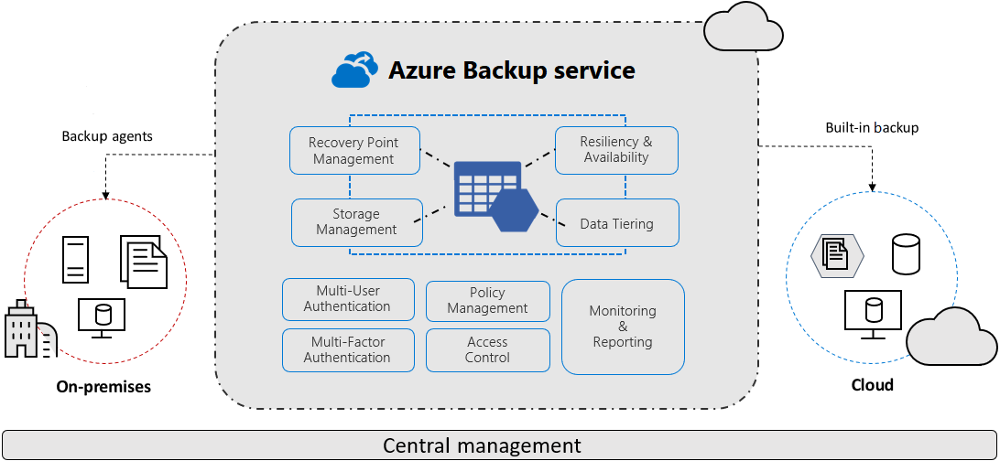
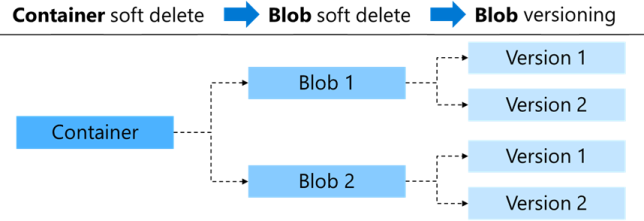
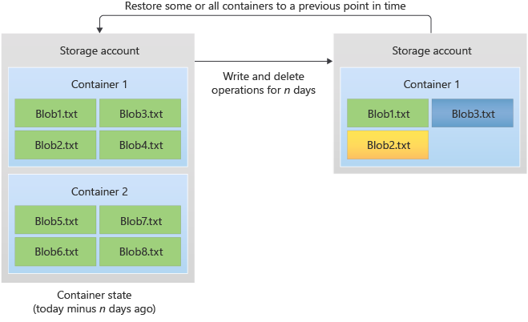
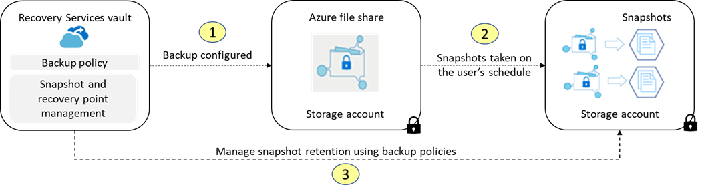
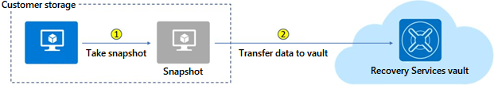
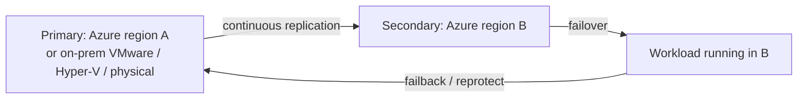
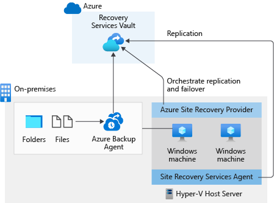

# Module 1: Design a solution for backup and disaster recovery
Units: Introduction · Design for backup and recovery · Design for Azure Backup · Design for Azure blob backup and recovery · Design for Azure Files backup and recovery · Design for Azure VM backup and recovery · Design for Azure SQL backup and recovery · Design for Azure Site Recovery · Knowledge check · Summary

Exam skills: recovery solution for Azure and hybrid workloads that meets recovery objectives · backup/recovery for compute, databases and unstructured data.

## Recovery objectives

- **RPO** (Recovery Point Objective): maximum acceptable **data loss**, measured in time.
- **RTO** (Recovery Time Objective): maximum acceptable **downtime**.
- Lower RPO/RTO = more cost. Define them per workload with the business (also SLA, MTTR, MTBF).
- **Backup** = restore data after loss/corruption/ransomware (hours). **Disaster recovery** = fail the whole workload over to another region (minutes).

## Azure Backup
- Agentless, managed, application-consistent backups. Stored in a vault.

| Vault | Protects |
|---|---|
| **Recovery Services vault** | Azure VMs, SQL Server / SAP HANA in VMs, Azure Files, MARS agent (on-prem files/folders), MABS/DPM, also Site Recovery |
| **Backup vault** | Newer workloads: Azure Blobs, Azure Disks, Azure Database for PostgreSQL, AKS, Data Lake Storage |
- **Backup center / Business Continuity Center**: single pane to govern backups across vaults.
- Vault storage redundancy: LRS, ZRS, **GRS** (default); **Cross Region Restore** lets you restore in the paired region.
- Security: **soft delete** (14 days, free), **immutable vaults**, **multi-user authorization** (Resource Guard), encryption with CMK.
- On premises: **MARS agent** (files/folders/system state, no separate server), **MABS / DPM** (app-aware: SQL, Exchange, Hyper-V, VMware).

*Diagram that shows the Azure Backup service with on-premises and cloud agents.*

## Blob storage protection
| Feature | Protects against |
|---|---|
| **Soft delete** (blobs and containers) | Accidental deletion, retention 1–365 days |
| **Versioning** | Overwrites; keeps previous versions automatically |
| **Point-in-time restore** | Restore block blobs to an earlier state (needs versioning, change feed, soft delete) |
| **Snapshots** | Manual read-only copy at a point in time |
| **Immutable storage (WORM)** | Time-based retention or legal hold; regulatory compliance (SEC 17a-4) |
| **Operational backup** (Backup vault) | Local continuous backup; **vaulted backup** copies off the account |
| **Resource lock** | Deletion of the storage account |
| **GRS/GZRS + account failover** | Regional outage |
| **Object replication** | Async copy of blobs to another account/region |

*Diagram that shows a high-level view of the soft delete feature.*

*Diagram that shows how point-in-time restore works.*

## Azure Files
- **Share snapshots** (up to 200; read-only, incremental) and **soft delete for shares**.
- Azure Backup for Azure Files: snapshot-based or **vaulted backup**, managed schedules and retention, file-level restore.

*Diagram that shows how Azure file shares snapshots are restored from a Recovery Services vault in Azure Backup.*

## Azure VMs
- Azure Backup takes **snapshots** (instant restore tier, 1–5 days) then transfers to the vault.
- Consistency: **application-consistent** (VSS on Windows, pre/post scripts on Linux) > file-system consistent > crash-consistent.
- Restore options: create new VM, restore disk, replace existing disk, cross-region restore, **file-level recovery**.
- **Enhanced policy**: multiple backups per day (hourly), Trusted Launch VMs.
- Managed **disk** backup (Backup vault) for incremental snapshot-based disk backup.

*Diagram that shows how Azure virtual machine snapshot backups are stored in a Recovery Services vault.*

## Azure SQL
| Service | Built-in backup |
|---|---|
| **Azure SQL Database / Managed Instance** | Automatic full (weekly), differential (12–24 h), log (~5–10 min). **PITR** retention 1–35 days (default 7) |
| | **Long-term retention (LTR)**: weekly/monthly/yearly backups up to **10 years** |
| | Backup storage redundancy: LRS, ZRS, GRS (enables **geo-restore** to any region) |
| SQL Server in a VM | Azure Backup for SQL in VM (15-minute log backups), or automated backup to storage |
- Geo-restore: RPO up to ~1 hour, RTO can be hours. For lower RPO/RTO use **active geo-replication / failover groups** (see the HA module).

## Azure Site Recovery (ASR): disaster recovery

- Replicates VMs continuously (RPO in **seconds to minutes**). Supports Azure-to-Azure, VMware, Hyper-V and physical servers to Azure.
- **Recovery plans**: order VM groups, add scripts/runbooks and manual actions.
- **Test failover**: in an isolated network, no impact on production. Do drills.
- Recovery points: crash-consistent (every 5 min) and app-consistent (configurable).
- Also used as a **migration** tool (but Azure Migrate is now preferred for migration).

*Diagram that shows a BCDR solution with Azure Site Recovery and Azure Backup.*

## Exam tips
- Restore a single file from a VM backup → **file-level recovery** in Azure Backup.
- Recover from accidental blob overwrite → **versioning** (or PITR).
- Keep SQL backups for 7 years → **LTR**.
- Whole app must run in another region within 30 minutes after a regional outage → **Azure Site Recovery** with a recovery plan.
- Back up on-prem files with no extra server → **MARS agent**.
- Backup must not be deletable by an admin → **immutable vault + soft delete + MUA**.
