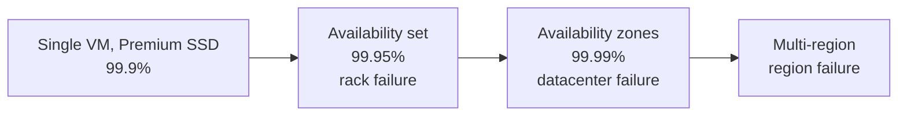
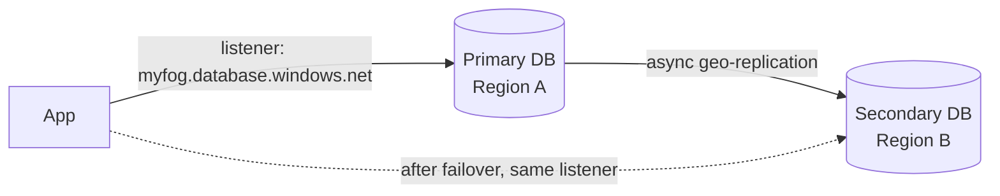

# Module 2: Design for high availability
Units: Introduction · Identify the availability requirements · Design for HA for compute (VMs, App Service, AKS, containers) · Design HA for non-relational data · Design HA for relational data · Knowledge check · Summary

Exam skills: HA for compute · HA for relational data · HA for semi-structured and unstructured data.

## Availability levels (and SLAs)

- Composite SLA = SLA1 × SLA2 × … (dependent services in series lower the total). Example: 99.95% × 99.99% ≈ 99.94%.
- Add redundancy in parallel to raise the composite SLA: 1 − (1 − a)².
- Ask: required uptime? Which failure must you survive (host, rack, zone, region)? Stateful or stateless?

## Compute HA
| Service | HA design |
|---|---|
| **VMs** | ≥2 VMs in an **availability set** (99.95%) or across **zones** (99.99%) behind a load balancer. **VMSS Flexible** orchestration spreads across zones and fault domains |
| **App Service** | Premium v2/v3 with **zone redundancy** (≥2–3 instances). Multi-region + **Front Door / Traffic Manager** for region failure |
| **AKS** | Node pools across **availability zones**, Standard/Premium tier (uptime SLA for the API server), multiple replicas + pod disruption budgets. Multi-region clusters for region failure |
| **Container Apps / ACI** | Container Apps environment with zone redundancy |
| **Azure Functions** | Premium/Flex Consumption with zone redundancy |
| Global routing | **Azure Front Door** (HTTP, anycast, WAF, fast failover) or **Traffic Manager** (DNS, any protocol) |

## Non-relational data HA
| Service | HA options |
|---|---|
| **Azure Storage** | ZRS (zone), GRS/GZRS (region), **RA-** for reads during an outage; **customer-managed account failover** |
| **Azure Cosmos DB** | Multi-region replication. **Single-write region** + automatic (service-managed) failover, or **multi-region writes** (99.999% read and write SLA). Zone redundancy per region. Choose a **consistency level** (Strong, Bounded staleness, Session (default), Consistent prefix, Eventual) |
| **Azure Cache for Redis / Azure Managed Redis** | Premium/Enterprise: zone redundancy, **geo-replication** (passive or active-active in Enterprise) |

## Relational data HA
| Service | HA options |
|---|---|
| **Azure SQL Database** | Built-in HA (99.99%). **Zone-redundant** config (General Purpose, Business Critical, Hyperscale). **Business Critical** has an Always On cluster with a readable secondary. |
| | **Active geo-replication**: up to 4 readable secondaries in any region, single database, manual failover, connection string changes |
| | **Auto-failover groups**: group of databases, **read/write and read-only listener endpoints** stay the same after failover, automatic or manual failover, 1 secondary region. Works for **SQL Managed Instance** too |
| **SQL Managed Instance** | Business Critical with zones; **failover groups** for regions |
| **SQL Server on VMs** | **Always On availability groups** (across zones/regions) or **failover cluster instances** (shared storage: Azure shared disks, Premium file shares, S2D) |
| **Azure Database for PostgreSQL/MySQL Flexible Server** | Zone-redundant HA (standby in another zone) or same-zone HA; **read replicas** / geo-restore for region |

## Exam tips
- Survive a datacenter failure with the least cost → **availability zones** (not multi-region).
- Multiple databases must fail over together and the app must not change its connection string → **auto-failover group**.
- Readable secondaries for reporting in up to 4 regions → **active geo-replication**.
- Global users must read and write with lowest latency → **Cosmos DB multi-region writes**.
- Lift-and-shift SQL cluster with shared storage → **FCI on Azure shared disks**; otherwise **Always On AG**.
- Non-HTTP app needs global DNS failover → **Traffic Manager**.
