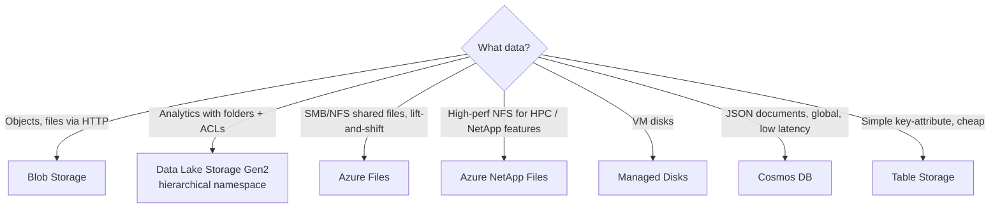

# Module 1: Design a data storage solution for non-relational data
Units: Introduction · Design for data storage · Design for Azure storage accounts · Design for data redundancy · Design for Azure Blob Storage · Design for Azure Files · Design an Azure disk solution · Design for storage security · Design for Azure Cosmos DB and tables · Knowledge check · Summary

Exam skills: store semi-structured and unstructured data · balance features, performance and cost · protection and durability.

## Classify the data
| Type | Examples | Typical store |
|---|---|---|
| Structured | Rows/columns, fixed schema | Azure SQL (next module) |
| **Semi-structured** | JSON, XML, key-value, graphs | **Cosmos DB**, Table storage |
| **Unstructured** | Images, video, PDFs, logs | **Blob**, Files, Data Lake |

## Storage account design
- Choose by: **workload type** (performance tier), **redundancy**, **region**, **billing/isolation**, **security**.
- Create separate accounts when you need different redundancy, regions, performance tiers, or a scalability-target limit is reached.
- **Standard GPv2** for most; **Premium** for low latency (block blob, file shares, page blob).

## Redundancy recap
| Need | Choose |
|---|---|
| Lowest cost, data can be recreated | LRS |
| Survive a zone failure, data stays in the region (residency) | **ZRS** |
| Survive a region failure | GRS / **GZRS** (best durability + availability) |
| Read from the secondary during an outage | **RA-GRS / RA-GZRS** |

## Blob storage
- Types: **block blob** (files, most common), **append blob** (logs), **page blob** (random read/write, VHDs).
- Access tiers: Hot / Cool (30 d) / Cold (90 d) / Archive (180 d, hours to rehydrate, Standard or High priority). **Lifecycle management** rules move/delete by age or last access.
- Immutable storage (WORM), versioning, soft delete, object replication (see BC module).
- **Data Lake Storage Gen2** = blob + **hierarchical namespace** (directories, POSIX ACLs, atomic renames) for big-data analytics.

## Azure Files and alternatives
| Option | Use |
|---|---|
| **Azure Files Standard** | General-purpose SMB shares, transaction-optimised/hot/cool tiers |
| **Azure Files Premium** | SSD, low latency, SMB and **NFS 4.1** |
| **Azure File Sync** | Cache on Windows Server, cloud tiering, multi-site sync |
| **Azure NetApp Files** | Enterprise NFS/SMB, sub-millisecond latency, HPC, SAP, Oracle |
- Identity-based access for SMB: on-prem **AD DS**, **Entra Domain Services**, or **Entra Kerberos** (hybrid identities). Then NTFS ACLs.

## Managed disks
| Type | Use |
|---|---|
| **Ultra Disk** | Most IOPS/throughput, adjustable live, SAP HANA, top-tier DBs, transaction-heavy |
| **Premium SSD v2** | Sub-ms latency, independently set IOPS/throughput, good price/perf for databases |
| **Premium SSD** | Production, performance-sensitive workloads |
| **Standard SSD** | Web servers, lightly used apps, dev/test |
| **Standard HDD** | Backup, non-critical, infrequent access |
- Disk encryption: SSE with platform or customer-managed keys, **encryption at host**, Azure Disk Encryption (guest OS). **Shared disks** for clustering.

## Storage security
- **Authorisation**: Entra ID + RBAC (recommended) > **SAS** (user delegation SAS best, then service, then account) > account keys (disable **shared key** if possible; rotate via Key Vault).
- **Stored access policy** lets you revoke service SAS.
- Network: **storage firewall**, **service endpoints**, **private endpoints** (private IP, best). Disable public network access.
- Require **secure transfer (HTTPS)**, minimum TLS 1.2. **Defender for Storage** detects malware and anomalies.
- Encryption at rest always on; **CMK** in Key Vault; **infrastructure (double) encryption**.

## Azure Cosmos DB
- Globally distributed, multi-model, single-digit-ms latency, SLAs for throughput, latency, consistency and availability.
- APIs: **NoSQL** (native, recommended for new), **MongoDB**, **Cassandra**, **Gremlin** (graph), **Table**, **PostgreSQL** (distributed relational). Pick the API that matches the existing app.
- Capacity: **provisioned throughput** (RU/s, manual or **autoscale**) or **serverless** (spiky/low traffic).
- **Partition key**: high cardinality, even spread of reads and writes. Critical for scale.
- Consistency (strongest → weakest): **Strong → Bounded staleness → Session (default) → Consistent prefix → Eventual**. Stronger = higher latency, lower availability.
- Features: change feed, TTL, analytical store (Synapse Link / Fabric mirroring), continuous backup with point-in-time restore.

| Azure Table storage | Cosmos DB for Table |
|---|---|
| Cheap, simple | Global distribution, SLA latency, auto indexing on all properties, dedicated throughput |

## Exam tips
- Cheapest storage for data kept 7 years and rarely read → **Archive tier + lifecycle policy**.
- Big-data analytics on files with folder-level ACLs → **Data Lake Storage Gen2**.
- Grant time-limited access to a blob without sharing keys, using Entra credentials → **user delegation SAS**.
- Access storage from a VNet over a private IP → **private endpoint**.
- Existing MongoDB app, minimal code change → **Cosmos DB for MongoDB**.
- Unpredictable, low traffic → **Cosmos DB serverless**.
