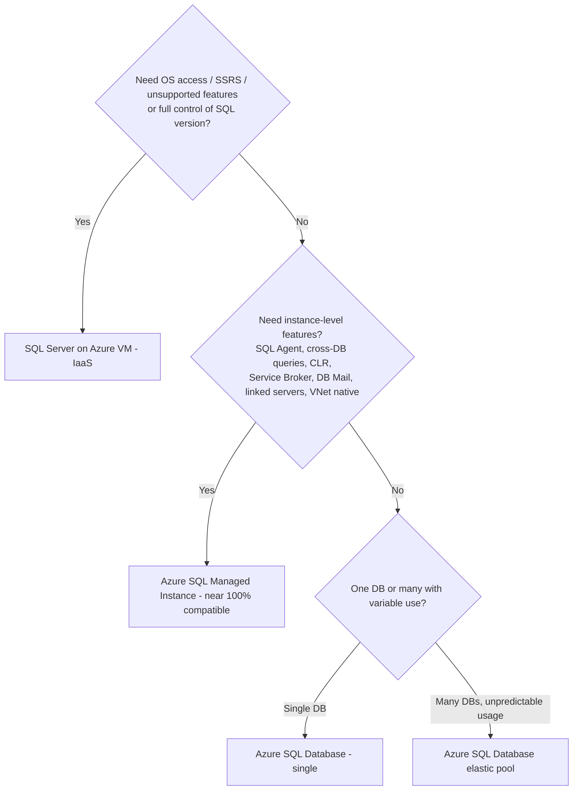
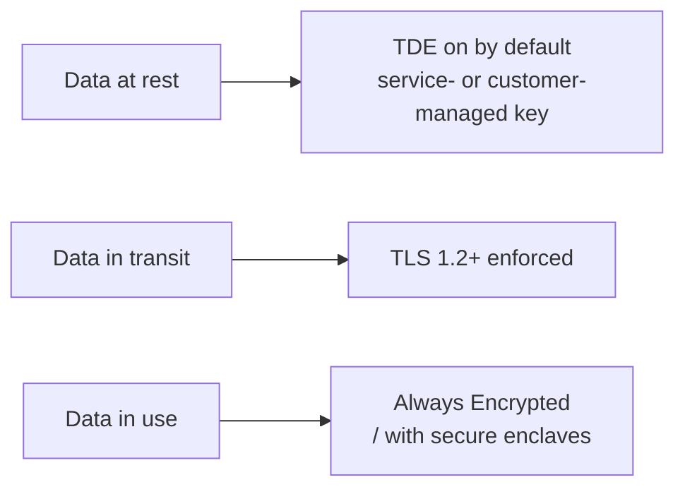

# Module 2: Design a data storage solution for relational data
Units: Introduction · Design for Azure SQL Database · Design for Azure SQL Managed Instance · Design for SQL Server on Azure VMs · Recommend a solution for database scalability · Recommend a solution for database availability · Design security for data at rest, in transit, in use · Design for Azure SQL Edge · Design for Azure Cosmos DB for PostgreSQL / open-source databases · Knowledge check · Summary

Exam skills: store relational data · service tier and compute tier · scalability · data protection.

## Choose the SQL offering

## Purchasing models and service tiers
| Model | Notes |
|---|---|
| **DTU** | Bundled CPU/IO/memory. Basic, Standard, Premium. Simple, preconfigured |
| **vCore** (recommended) | Choose vCores, memory and storage independently. Supports **Azure Hybrid Benefit** (reuse SQL licences) and reserved capacity |

| vCore tier | Use | Key facts |
|---|---|---|
| **General Purpose** | Most business workloads | Remote storage, budget-friendly; 99.99% |
| **Business Critical** | Low latency, high IO, OLTP | Local SSD, Always On replicas, **1 free readable secondary (read scale-out)**, zone redundancy |
| **Hyperscale** | Very large DBs (up to **128 TB**), fast scale | Fast backups/restores, up to 4 HA replicas + named replicas for read scale |

Compute tiers (SQL Database): **Provisioned** (always on) vs **Serverless** (auto-scales vCores, **auto-pauses** when idle, billed per second; great for intermittent use, dev/test).

## Scalability
| Technique | Meaning |
|---|---|
| **Vertical scaling** | Change tier/vCores (scale up/down) |
| **Elastic pool** | Many databases share a pool of resources (SaaS multi-tenant, uneven usage) |
| **Read scale-out** | Offload reads to a replica (`ApplicationIntent=ReadOnly`) |
| **Horizontal (sharding)** | Split data across databases; **Elastic Database tools** (shard map manager), **elastic query** |
| **Hyperscale** | Up to 128 TB, named replicas |

## Availability (see BC module)
Zone redundancy · active geo-replication · auto-failover groups · Always On AG / FCI for VMs.

## Security

| Feature | Purpose |
|---|---|
| **TDE** | Encrypts database files at rest; CMK (BYOK) in Key Vault |
| **Always Encrypted** | Column encryption; keys stay with the client, so **DBAs cannot see** plaintext |
| **Dynamic data masking** | Hides data in query results from non-privileged users (for example `XXX-XX-1234`) |
| **Row-level security** | Filters rows per user (multi-tenant) |
| **Entra ID authentication** | Central identity, MFA, managed identities; Entra-only auth |
| **Firewall rules / private endpoint** | Network control; disable public access |
| **Microsoft Defender for SQL** | Vulnerability assessment + advanced threat protection (SQL injection, anomalous access) |
| **Auditing** | Writes audit logs to Storage, Log Analytics or Event Hubs; **Ledger** for tamper evidence |
| **Data discovery & classification** | Label sensitive columns |

## Other relational options
- **Azure SQL Edge**: small-footprint SQL for IoT/edge devices with data streaming and time-series.
- **Azure Database for PostgreSQL / MySQL Flexible Server**: managed open-source engines, zone-redundant HA, burstable/general/memory-optimised tiers.
- **Azure Cosmos DB for PostgreSQL** (Citus): distributed PostgreSQL for multi-tenant and real-time analytics at scale.

## Exam tips
- Migrate app that uses **SQL Agent jobs and cross-database queries** with minimal changes, PaaS → **SQL Managed Instance**.
- 200 SaaS tenant databases with unpredictable peaks → **elastic pool**.
- DB used only a few hours a day, minimise cost → **serverless compute tier**.
- Database > 4 TB growing to 50 TB → **Hyperscale**.
- DBAs must not read credit-card numbers → **Always Encrypted**.
- Show only last 4 digits to support staff → **dynamic data masking**.
- Reuse existing SQL Server licences → **vCore + Azure Hybrid Benefit**.
