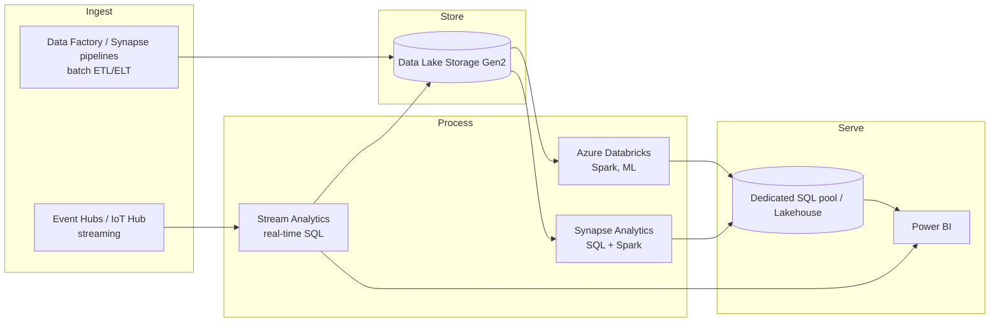
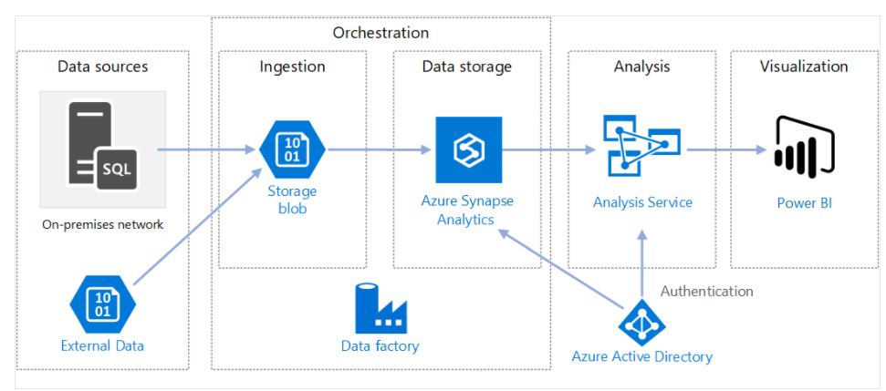
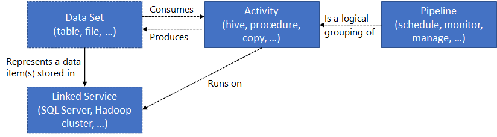
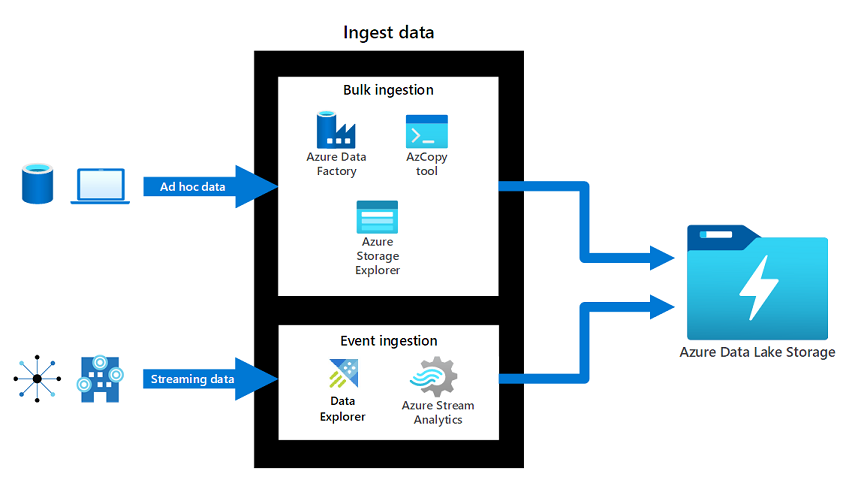
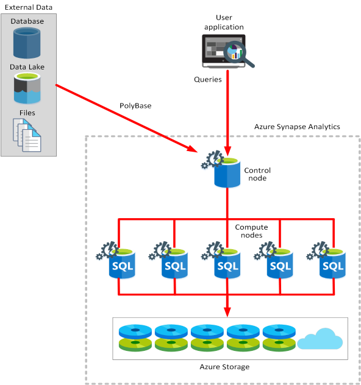
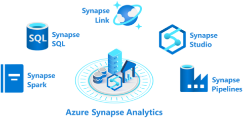
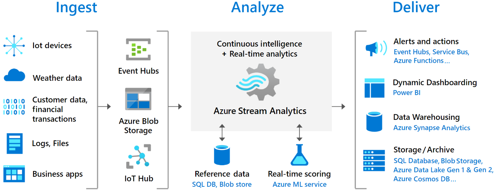

# Module 3: Design data integration
Units: Introduction · Design a data integration solution with Azure Data Factory · Design a data analysis solution with Azure Data Lake · Design a data analysis solution with Azure Databricks · Design a data analysis solution with Azure Synapse Analytics · Design strategies for hot, warm and cold data paths · Design an Azure Stream Analytics solution · Knowledge check · Summary

Exam skills: recommend a data integration solution · recommend a data analysis solution.

> Microsoft Fabric is the newer unified SaaS analytics platform (OneLake, Data Factory, Data Engineering, Warehouse, Real-Time Intelligence, Power BI). Know it exists; the exam objectives still centre on the services below.

## Azure Data Factory (ADF)
- Cloud **ETL/ELT and orchestration**. 90+ connectors. Code-free **mapping data flows**.
- Components: **pipelines** (workflow) → **activities** (copy, data flow, notebook, stored proc) → **datasets** → **linked services** (connections) → **triggers** (schedule, tumbling window, storage event, custom event) → **integration runtime**.

| Integration runtime | Use |
|---|---|
| **Azure IR** | Cloud-to-cloud data movement and data flows |
| **Self-hosted IR** | Access **on-premises or private network** data sources |
| **Azure-SSIS IR** | **Lift-and-shift existing SSIS packages** |

*Diagram that shows the Azure Data Factory architecture.*

*Diagram that shows a pipeline, activities, data sets, and linked services in Azure Data Factory.*

## Azure Data Lake Storage Gen2
- Blob storage + hierarchical namespace. The foundation for big-data analytics. Stores raw → cleansed → curated zones (**medallion**: bronze/silver/gold).
- Security: RBAC + POSIX **ACLs**, private endpoints.

*Diagram that shows how unplanned data and streaming data are either bulk ingested or unplanned ingested in Azure Data Lake Storage.*

## Azure Databricks
- Apache **Spark**-based analytics platform. Collaborative notebooks (Python, Scala, SQL, R), **Delta Lake**, **ML/AI**, Unity Catalog for governance.
- Choose for: data engineering at scale, data science/ML, streaming with Spark, open lakehouse.

## Azure Synapse Analytics
- Unified analytics: **serverless SQL pool** (query lake files, pay per TB scanned), **dedicated SQL pool** (enterprise **data warehouse**, MPP), **Apache Spark pools**, **Synapse pipelines** (ADF built in), **Synapse Link** (near-real-time analytics on Cosmos DB/SQL without ETL).
- Choose for: enterprise data warehousing and SQL-based analytics over big data.

| Need | Choose |
|---|---|
| Orchestrate and copy data, schedule ETL | **Data Factory** |
| Enterprise data warehouse with T-SQL | **Synapse dedicated SQL pool** (or Fabric Warehouse) |
| Ad-hoc SQL over files in the lake | **Synapse serverless SQL pool** |
| Spark ML, data science, notebooks | **Databricks** |
| Real-time stream processing with SQL | **Stream Analytics** |
| Analytics on Cosmos DB without hurting OLTP | **Synapse Link** |

*Diagram that shows the Azure Synapse Analytics architecture.*

*Diagram that shows an overview of Azure Synapse Analytics capabilities.*

## Hot, warm and cold data paths (Lambda-style)
| Path | Latency | Example |
|---|---|---|
| **Hot** | Real time (seconds) | Stream Analytics → Power BI dashboard, alerts |
| **Warm** | Near real time (minutes) | Recent data in Cosmos DB / Data Explorer / SQL for queries |
| **Cold** | Batch (hours) | Data Lake + Databricks/Synapse for historical analysis |

## Azure Stream Analytics
- Real-time analytics with a **SQL-like query language**. Inputs: **Event Hubs, IoT Hub, Blob/ADLS** (reference data). Outputs: Power BI, SQL, Cosmos DB, Data Lake, Functions, Service Bus.
- **Windowing functions**: tumbling (fixed, non-overlapping), hopping (overlapping), sliding, session, snapshot.
- Fully managed, measured in streaming units; can run on IoT Edge.

*Diagram that shows the Stream Analytics pipeline, and how data is ingested, analyzed, and sent for presentation or action.*

## Exam tips
- Copy on-prem SQL Server data to Azure every night → **ADF + self-hosted IR**.
- Existing SSIS packages to run in the cloud with minimal change → **ADF Azure-SSIS IR**.
- Detect anomalies in IoT telemetry within seconds using SQL → **Stream Analytics**.
- Data scientists need collaborative Spark notebooks and ML → **Databricks**.
- Petabyte-scale data warehouse with T-SQL → **Synapse dedicated SQL pool**.
