# Module 1: Design an Azure compute solution
Units: Introduction · Choose an Azure compute service · Design for Azure virtual machine solutions · Design for Azure Batch solutions · Design for Azure App Service solutions · Design for Azure Container Instances solutions · Design for Azure Kubernetes Service solutions · Design for Azure Functions solutions · Design for Azure Logic Apps solutions · Knowledge check · Summary

Exam skills: specify compute components · VM-based · container-based · serverless-based · batch processing.

## Compute decision tree (memorise)
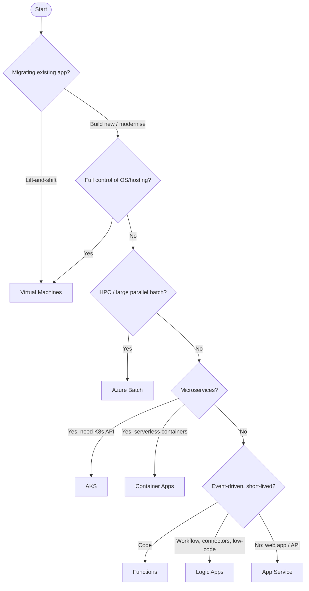

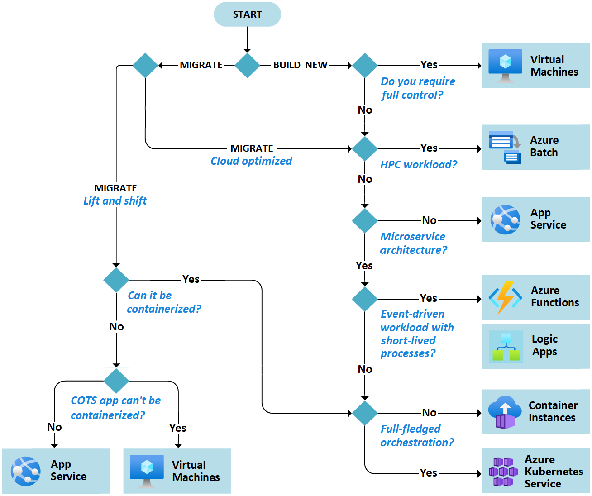
*Diagram that shows considerations and options for Azure compute solutions.*

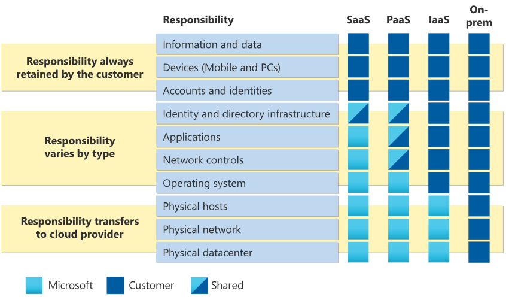
*Diagram that highlights the developer and cloud provider responsibilities for infrastructure and platform services.*

## Virtual machines
- Decide: **region**, **size family** (B burstable, D general, E/M memory, F compute, L storage, N GPU, H HPC), **disks**, **image**, **availability** (sets/zones/VMSS), **cost** (Reserved Instances, Savings plan, **Spot VMs** for interruptible jobs, Azure Hybrid Benefit, auto-shutdown).
- **VM Scale Sets**: autoscale by metrics or schedule; **Flexible** orchestration (mix sizes, zones) is recommended.
- **Azure Dedicated Host**: physical server for compliance/licensing isolation.
- **Azure Compute Gallery**: share/version images across regions.
- Manage at scale: **Azure Update Manager**, **Machine Configuration**, **Azure Bastion** (RDP/SSH via browser, no public IP), **JIT VM access** (Defender for Cloud).

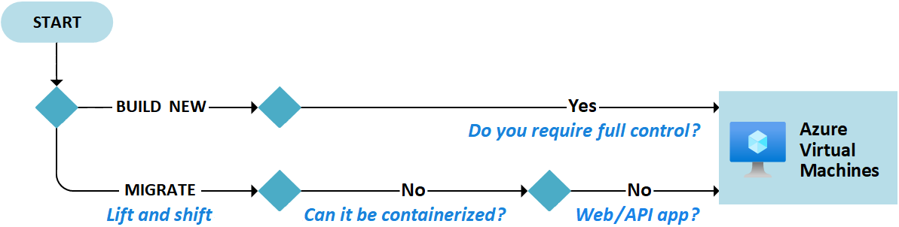
*Flowchart that shows the decision tree for selecting Azure Virtual Machines to build new workloads and to support lift and shift migration.*

## Azure Batch
- Large-scale **parallel and HPC** batch jobs. Batch manages a **pool** of compute nodes, **jobs** and **tasks**; autoscale formulas; use **low-priority/Spot** nodes to cut cost.
- **Intrinsically parallel** (independent tasks, for example rendering frames, Monte Carlo) and **tightly coupled** (MPI, needs InfiniBand H-series).

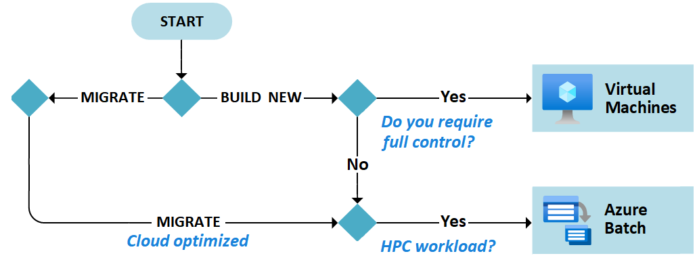
*Flowchart that shows the decision tree for selecting Azure Batch to build new workloads, and to support lift and shift or cloud-optimized migrations.*

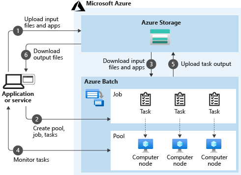
*Diagram that shows how Azure Batch works to upload, download, create, and monitor tasks.*

## Azure App Service
- PaaS for web apps, REST APIs and mobile back ends. Plans: Free/Shared (dev), Basic, **Standard** (autoscale, slots), **Premium v3** (zone redundancy, VNet, more scale), **Isolated v2** (App Service Environment v3: single-tenant, full network isolation, compliance).
- **Deployment slots**: staging → **swap** for zero-downtime deployment and instant rollback.
- **VNet integration** (outbound to VNet) and **private endpoints** (inbound private).
- Autoscale out by rules; scale up by changing plan.

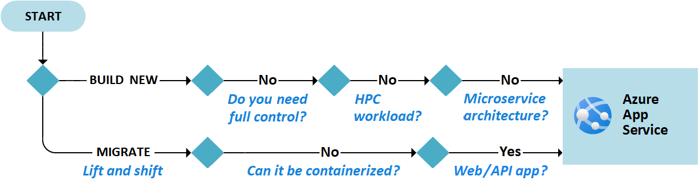
*Flowchart that shows the decision tree for selecting Azure App Service to build new workloads and to support lift and shift migrations.*

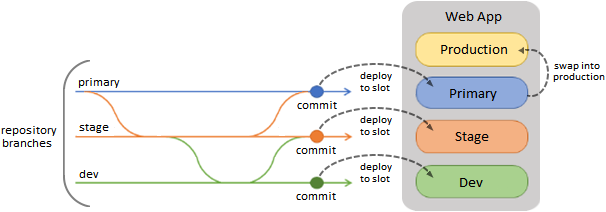
*Diagram that shows container slots for development, staging, primary, and production when using Azure App Service.*

## Containers
| Service | Choose when |
|---|---|
| **ACI** | Simple, isolated containers, burst workloads, quick tasks, no orchestration. **Container groups** (like a pod). Can be a **virtual node** for AKS burst |
| **Container Apps** | Microservices and APIs, **scale to zero**, KEDA event-driven scaling, Dapr, revisions/traffic split, without managing Kubernetes |
| **AKS** | Full Kubernetes: complex microservices, custom operators, fine-grained control. Node pools (system/user, Spot), cluster autoscaler + HPA, Entra ID integration, Azure CNI networking |

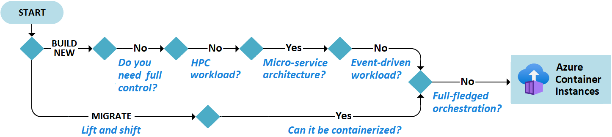
*Flowchart that shows the decision tree for selecting Azure Container Instances to build new workloads and to support lift and shift migrations.*

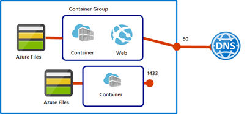
*Diagram that shows container groups with access from DNS on port 80 and Azure files on port 1433.*

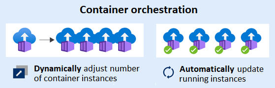
*Diagram that shows how container orchestration dynamically or automatically scales container instances.*

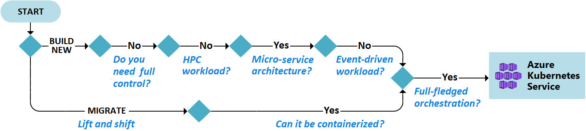
*Flowchart that shows the decision tree for selecting Azure Kubernetes Service to build new workloads and to support lift and shift migrations.*

## Serverless
### Azure Functions
| Plan | Notes |
|---|---|
| **Flex Consumption** / Consumption | Pay per execution, scale to zero, possible cold start (Flex adds VNet + always-ready instances) |
| **Premium** | Pre-warmed instances (no cold start), VNet, longer runs |
| **Dedicated (App Service plan)** | Predictable cost, runs on existing plan |
- Triggers and bindings simplify input/output. **Durable Functions** for stateful workflows (function chaining, fan-out/fan-in, human interaction).

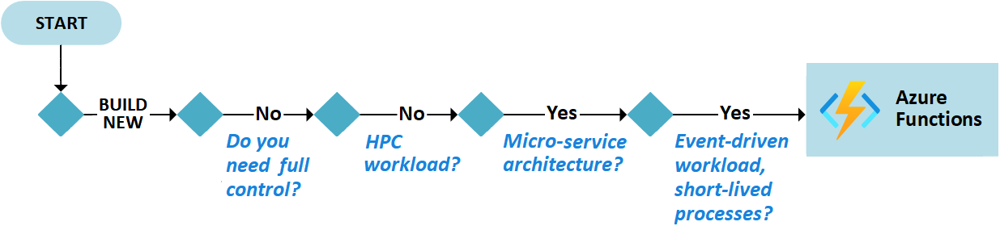
*Flowchart for selecting Azure Functions solutions to build new workloads.*

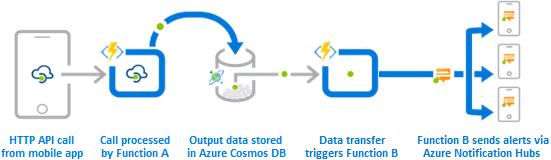
*Diagram that shows how Azure Functions responds to API calls and outputs data to Azure Notification Hubs.*

### Azure Logic Apps
- **Low-code workflow** designer with 1,000+ **connectors** (Office 365, SAP, Salesforce, SQL). Enterprise integration (B2B, EDI, XML).
- **Consumption** (multi-tenant, pay per action) vs **Standard** (single-tenant, VNet, stateful/stateless workflows).

| Functions | Logic Apps |
|---|---|
| Code-first (C#, JS, Python…) | Designer-first, connectors |
| Custom logic, complex processing | Integrations and orchestration between SaaS systems |

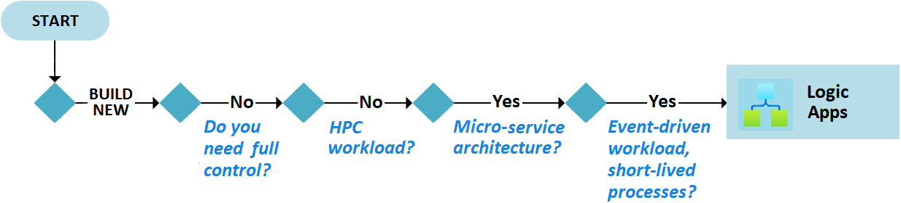
*Flowchart for selecting Azure Logic Apps solutions to build new workloads.*

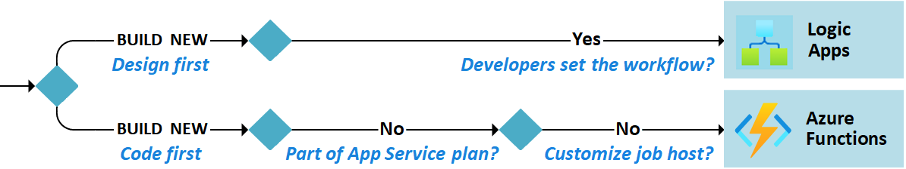
*Flowchart that shows the decision tree for when to use Azure Functions and Azure Logic Apps.*

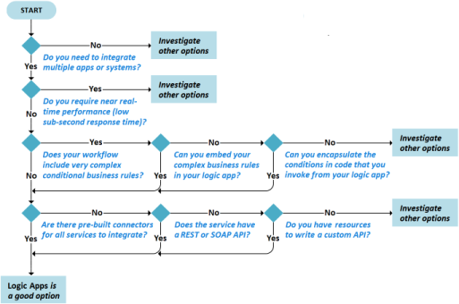
*Flowchart that shows a detailed decision tree for when to use Azure Logic Apps.*

## Exam tips
- Rendering thousands of frames overnight cheaply → **Azure Batch with Spot/low-priority nodes**.
- Stateless microservices that should scale to zero, no K8s skills → **Container Apps**.
- Web app needs zero-downtime deployment → **App Service deployment slots**.
- Must run in a fully isolated single-tenant environment → **App Service Environment (Isolated v2)**.
- Workflow when an email arrives, save attachment to SharePoint → **Logic Apps**.
- Function must never have cold starts and needs VNet → **Functions Premium plan**.
- Interruptible dev/test or batch VMs at lowest cost → **Spot VMs**.
