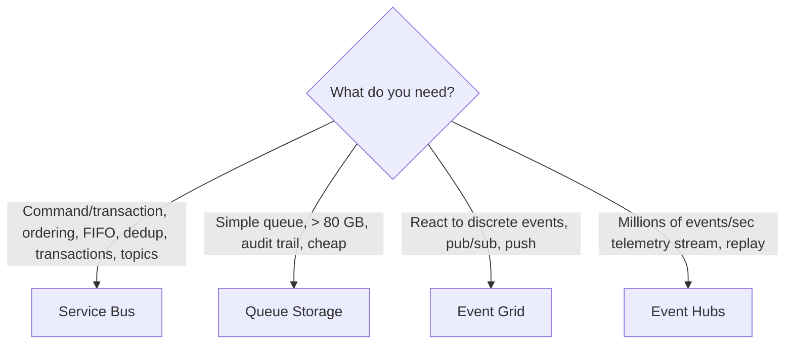
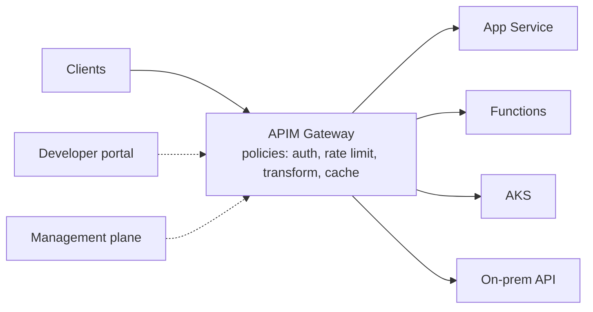

# Module 2: Design an application architecture
Units: Introduction · Describe message and event scenarios · Design a messaging solution · Design an Azure Event Hubs messaging solution · Design an event-driven solution · Design a caching solution · Design API integration · Design an application configuration management solution · Design an automated app deployment solution · Knowledge check · Summary

Exam skills: messaging · event-driven · API integration · caching · app configuration management · automated deployment.

## Message vs event
| Message | Event |
|---|---|
| Sender **expects** the receiver to act; contains the data/command | A lightweight **notification** that something happened; publisher has no expectation |
| Example: "Process order 123" | Example: "Blob uploaded", "Temperature reading" |
| Services: **Queue Storage, Service Bus** | Services: **Event Grid** (discrete events), **Event Hubs** (event streams) |

## Queue Storage vs Service Bus
| Queue Storage | Service Bus |
|---|---|
| Messages ≤ 64 KB, queue can be **> 80 GB** | Messages up to 256 KB (Standard) / 100 MB (Premium) |
| Simple, cheap, server-side logs of transactions | **FIFO (sessions)**, **duplicate detection**, **dead-letter queue**, **transactions**, scheduled delivery |
| No ordering guarantee | **Topics + subscriptions** (publish/subscribe with filters) |
| At-least-once | At-least-once and at-most-once (ReceiveAndDelete) |

## Event Hubs
- Big-data **streaming ingestion** (millions of events/s). **Partitions** for parallelism, **consumer groups** for independent readers, **retention and replay**.
- **Capture** writes events automatically to Blob/Data Lake. **Kafka endpoint** (use existing Kafka clients).
- Tiers: Basic, Standard, Premium, Dedicated.

## Event Grid
- Serverless **event routing**, push-based, **pub/sub** with filtering. Sources: Blob storage, resource groups, subscriptions, custom topics, IoT Hub. Handlers: Functions, Logic Apps, webhooks, Service Bus, Event Hubs, Storage queues.
- Retry with exponential backoff, dead-lettering. Supports MQTT (namespaces).

## Caching
| Option | Use |
|---|---|
| **Azure Cache for Redis / Azure Managed Redis** | In-memory cache, session store, leaderboard, message broker. Tiers: Basic (no SLA), Standard (replica), Premium (clustering, persistence, VNet, geo-replication), Enterprise (Redis modules, active geo-replication) |
| **Azure CDN / Front Door** | Cache **static content** close to users at the edge |
| Patterns | **Cache-aside** (load on miss), expiration/TTL, content cache, session cache |

## API integration: Azure API Management (APIM)

- Components: **gateway**, **management plane**, **developer portal**. Products, subscriptions (keys), versions/revisions.
- **Policies**: JWT validation, rate limiting/quotas, IP filtering, caching, request/response transformation (XML↔JSON), mocking.
- Tiers: Consumption (serverless), Developer (no SLA), Basic/Standard/Premium (+ v2 tiers). **Premium**: multi-region, VNet injection, zones. **Self-hosted gateway** for on-prem/multicloud.

## Application configuration management
- **Azure App Configuration**: central store for settings and **feature flags** (feature management, gradual rollout), labels per environment, point-in-time snapshots. Reference **Key Vault** for secrets.
- Key Vault = secrets; App Configuration = non-secret settings.

## Automated deployment
- **Infrastructure as code**: **ARM templates** (JSON), **Bicep** (simpler DSL, compiles to ARM), Terraform. Use **template specs** to share. **Deployment stacks** manage resources as a unit.
- **CI/CD**: **Azure DevOps Pipelines** or **GitHub Actions** (use workload identity federation). Environments with approvals.
- Strategies: deployment slots (App Service), blue/green, canary, rolling; feature flags.
- **Azure Deployment Environments** for self-service dev environments.

## Exam tips
- Orders must be processed **in order** and **exactly once detection** → **Service Bus sessions + duplicate detection**.
- One message to multiple subscribers with filters → **Service Bus topics**.
- Run a Function when a blob is created → **Event Grid**.
- Ingest telemetry from millions of devices and replay → **Event Hubs**.
- Publish APIs securely to partners with throttling and a portal → **API Management**.
- Turn features on/off without redeploying → **App Configuration feature flags**.
- Reduce DB load for frequently read data → **Azure Cache for Redis (cache-aside)**.
