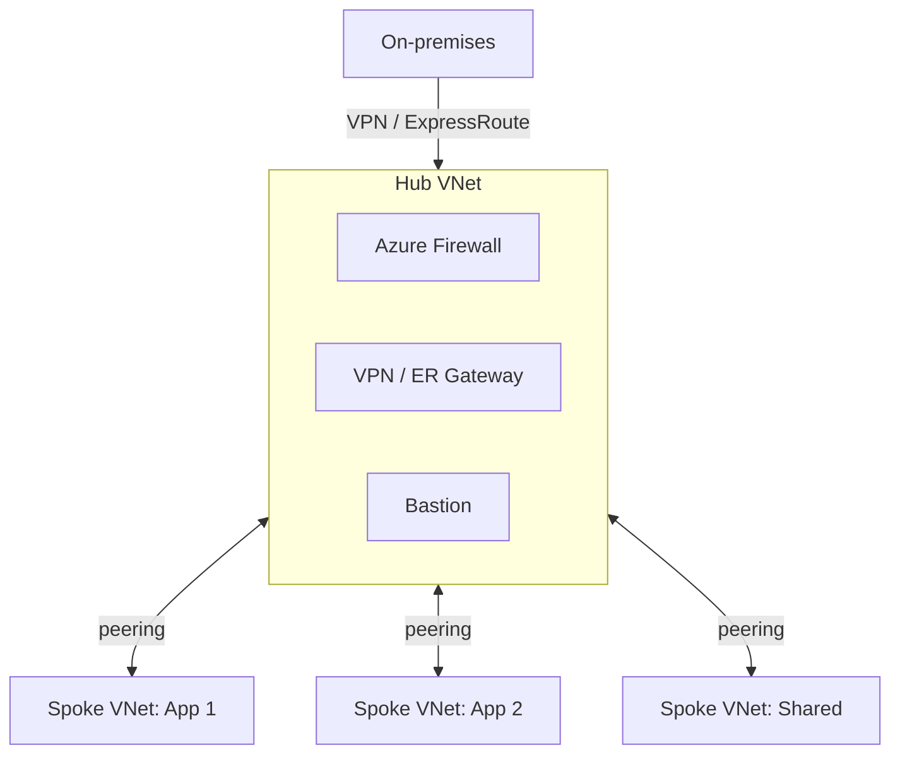
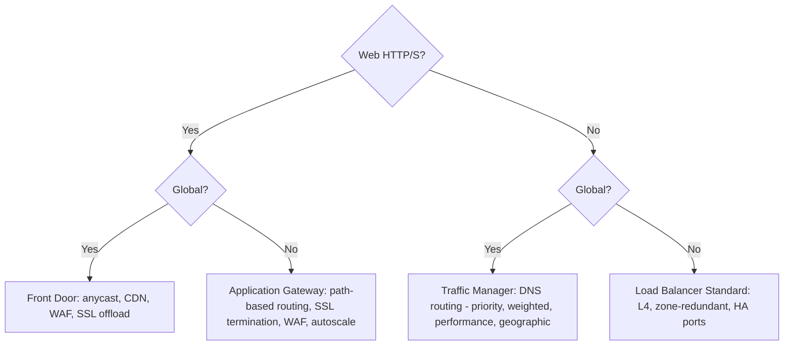

# Module 3: Design network solutions
Units: Introduction · Recommend a network architecture solution based on workload requirements · Design for on-premises connectivity to Azure Virtual Network · Design for Azure network connectivity services · Design for application delivery services · Design for application protection services · Knowledge check · Summary

Exam skills: connect to the internet · connect to on-premises · optimise network performance · optimise network security · load balancing and routing.

## Network architecture: hub-spoke vs Virtual WAN

- **Hub-spoke**: shared services centralised in the hub; spokes peered to the hub; spoke-to-spoke traffic through the firewall (**UDRs**). **Gateway transit** lets spokes use the hub gateway.
- **Azure Virtual WAN**: Microsoft-managed hub(s) with built-in any-to-any routing, branch VPN, ExpressRoute, P2S at large scale. Choose for **many branches/regions** and less management.
- **VNet peering**: low-latency, private Microsoft backbone, **non-transitive**. Global peering works across regions.
- Plan non-overlapping IP address spaces; use subnets for segmentation. **Azure Virtual Network Manager** manages connectivity/security rules at scale.

## Connect to on-premises
| Option | Facts |
|---|---|
| **Site-to-site VPN** | IPsec over internet, up to ~10 Gbps aggregate (gateway SKU), quick to set up, cheap |
| **Point-to-site VPN** | Individual clients (OpenVPN, IKEv2, SSTP), Entra ID auth |
| **ExpressRoute** | **Private** connection via a provider, **does not use the internet**, up to 100 Gbps, predictable latency, SLA. Private peering (VNets) and Microsoft peering (Microsoft 365, public PaaS) |
| **ExpressRoute Global Reach** | Connect on-prem sites to each other through ExpressRoute |
| **ExpressRoute Direct** | Direct 10/100 Gbps ports to Microsoft |
| **ExpressRoute FastPath** | Bypasses the gateway for better data path performance |
| **ER + S2S VPN failover** | VPN as a backup path for ExpressRoute |
- Encryption over ExpressRoute: **MACsec** (Direct) or IPsec VPN over private peering.
- Resilience: zone-redundant gateways (`AZ` SKUs), active-active VPN, two ER circuits in different peering locations.

## Connectivity to Azure services and DNS
| Option | Facts |
|---|---|
| **Service endpoint** | Extends VNet identity to a PaaS service; traffic stays on backbone; service still has a **public IP**; not usable from on-prem |
| **Private endpoint (Private Link)** | Gives the PaaS resource a **private IP in your VNet**; reachable from on-prem and peered VNets; protects against data exfiltration; needs **Private DNS zone** |
| **Private Link service** | Expose **your own** service behind a Standard LB privately to consumers |
| **Azure DNS / Private DNS / DNS Private Resolver** | Hosted public DNS, private name resolution, **conditional forwarding between on-prem and Azure** without VMs |
| **NAT Gateway** | Scalable, static **outbound** internet IPs for a subnet; avoids SNAT port exhaustion |

## Load balancing and routing (memorise this matrix)
| | Global (multi-region) | Regional |
|---|---|---|
| **HTTP(S)** (layer 7) | **Azure Front Door** | **Application Gateway** |
| **Non-HTTP** (layer 4, TCP/UDP) | **Traffic Manager** (DNS) / cross-region Load Balancer | **Azure Load Balancer** |

- Common combination: **Front Door → Application Gateway → VMs/AKS** in each region.
- Traffic Manager routing methods: priority (failover), weighted, performance (closest), geographic (data sovereignty), multivalue, subnet.
- Load Balancer: Standard SKU (zones, SLA); Gateway LB for NVA chaining.

## Application protection and network security
| Service | Protects |
|---|---|
| **NSG** | L3/L4 allow/deny rules on subnet/NIC; **service tags** and **application security groups (ASGs)** |
| **Azure Firewall** | Managed, stateful firewall: L3–L7, FQDN filtering, threat intelligence, **Premium**: TLS inspection, IDPS, URL filtering. **Firewall Manager** for central policy |
| **Web Application Firewall (WAF)** | OWASP top 10 (SQLi, XSS) on **Front Door** or **Application Gateway** |
| **Azure DDoS Protection** | Network Protection (per VNet plan) or IP Protection; always-on monitoring, adaptive tuning, cost protection |
| **Azure Bastion** | Secure RDP/SSH without public IPs |
| **NVA** | Third-party firewalls from Marketplace |
| **UDR / route tables** | Force tunnelling traffic through firewall/NVA |

## Optimise performance
- **Accelerated networking** (SR-IOV) on VMs, **proximity placement groups** (lowest latency between VMs), ExpressRoute FastPath, **CDN/Front Door** caching, choose regions near users, **Network Watcher** for diagnosis.

## Exam tips
- Private, predictable, high-bandwidth link to Azure not over the internet → **ExpressRoute**.
- Access Azure SQL from on-prem over a private IP → **private endpoint** (+ DNS Private Resolver).
- Global web app with WAF and fastest failover → **Front Door (with WAF)**.
- Route `/images/*` to one pool and `/video/*` to another in one region → **Application Gateway**.
- Filter outbound traffic by FQDN centrally → **Azure Firewall**.
- Spokes need to talk to each other through a hub → peering + **UDR to Azure Firewall** (peering is non-transitive), or **Virtual WAN**.
- Hundreds of branch offices → **Virtual WAN**.
