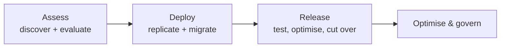
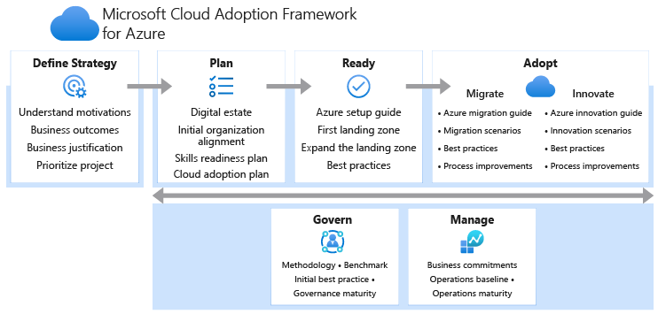
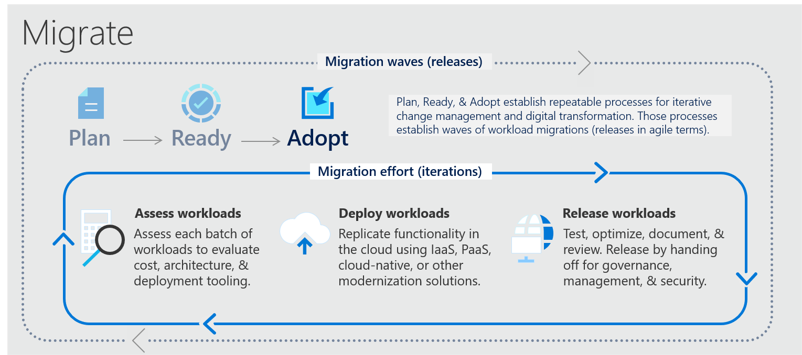
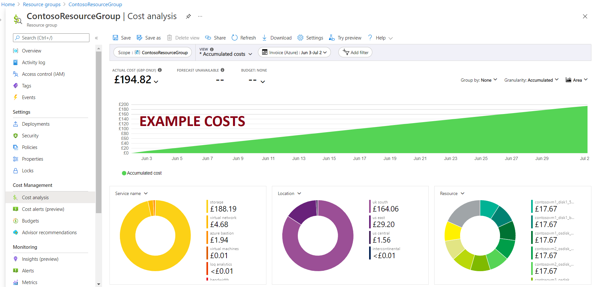
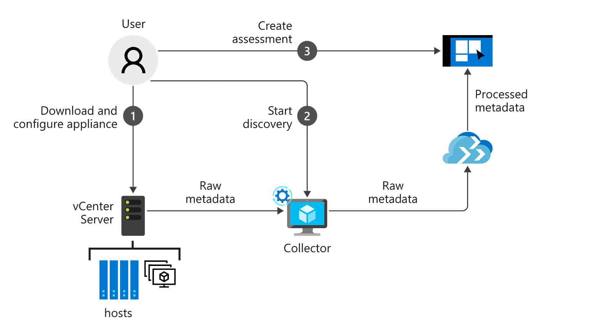
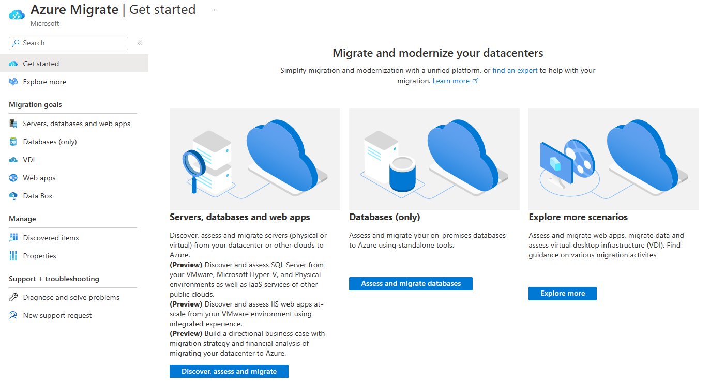
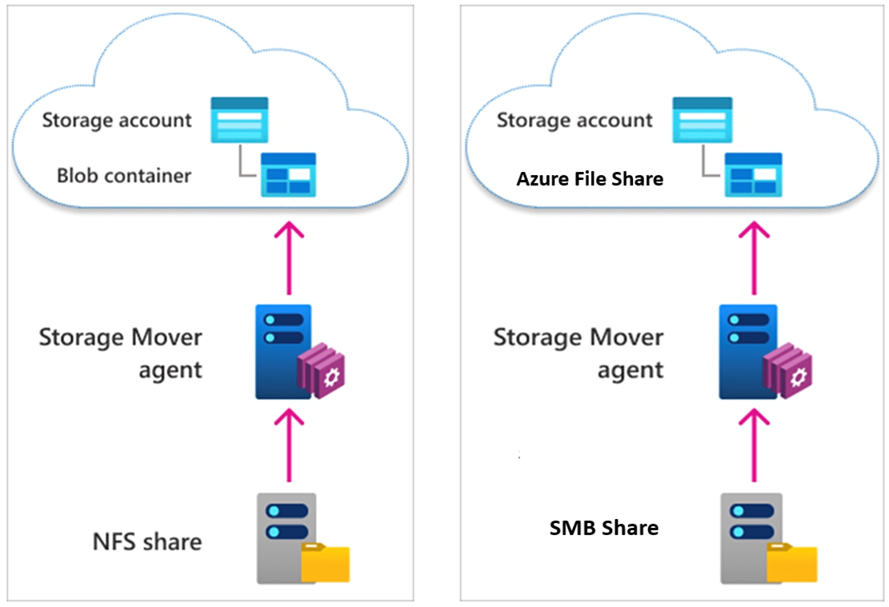

# Module 4: Design migrations
Units: Introduction · Evaluate migration with the Cloud Adoption Framework · Describe the Azure migration framework · Assess your on-premises workloads · Select a migration tool · Migrate your databases · Select an online storage migration tool for unstructured data · Migrate offline data · Knowledge check · Summary

Exam skills: evaluate migration with CAF · evaluate on-prem servers, data and apps · migrate workloads to IaaS and PaaS · migrate databases · migrate unstructured data.

## Migration framework (CAF)

CAF phases: Strategy → Plan → Ready (landing zone) → **Migrate** (Assess → Deploy → Release). Strategies: retire, rehost, replatform, refactor, rearchitect, rebuild, replace (see [CAF module](../01-AZ-305-Prerequisites/05-Cloud-Adoption-Framework.md)).

*Diagram that shows Cloud Adoption Framework methodologies, including strategy, plan, ready, adopt, govern, and manage.*

*Diagram of migration adoption efforts for workloads, including assess, deploy, and release.*

## Assess on-premises workloads
- **Azure Migrate**: central hub. **Discovery and assessment** with the **Azure Migrate appliance** (agentless for VMware, Hyper-V, physical). Produces readiness, right-sized Azure targets, cost estimates.
- **Dependency analysis** (agentless or agent-based) shows which servers talk to each other, so you migrate groups together.
- Assessments for: Azure VMs, Azure SQL, Azure App Service, AKS, Azure VMware Solution (AVS), and **business case**.
- **Azure Migrate business case** and the **TCO calculator** for cost justification.

*Screenshot that shows a cost analysis example with estimated costs in the Azure portal.*

*Flowchart that shows how to do discovery and assessment with the Azure Migrate Discovery and Assessment tool.*

*Screenshot that shows Azure Migrate: Discovery and assessment tools.*

## Migrate servers and apps
| Tool | Use |
|---|---|
| **Azure Migrate: Server Migration** | Rehost VMware/Hyper-V/physical/other clouds to Azure VMs (agentless or agent-based) |
| **Azure VMware Solution** | Run VMware workloads natively in Azure (vSphere, HCX for migration) |
| **App Service Migration Assistant** / Azure Migrate web app migration | .NET/Java web apps to **App Service** |
| **Azure Site Recovery** | Can also migrate VMs (DR tool) |

## Migrate databases
| Tool | Use |
|---|---|
| **Data Migration Assistant (DMA)** | Assess SQL Server compatibility issues and feature parity (legacy; functions now in Azure Migrate / SQL migration extension) |
| **Azure SQL migration extension for Azure Data Studio** / **Azure Database Migration Service (DMS)** | Perform migrations to SQL DB, SQL MI, SQL on VM. **Online** (minimal downtime) or **offline** |
| **Log Replay Service / Managed Instance link** | Near-zero-downtime migration to SQL MI |
| Native backup/restore | `.bak` to SQL MI or SQL on VM |
| **DMS for MySQL/PostgreSQL/MongoDB** | Open-source DB migrations |

Choose target: compatibility needs → **SQL MI**; full control → **SQL on VM**; modern PaaS → **SQL Database**.

## Migrate unstructured data (online)
| Tool | Use |
|---|---|
| **AzCopy** | Command-line copy to Blob/Files; scripted, high performance |
| **Azure Storage Explorer** | GUI for small transfers |
| **Azure File Sync** | Migrate Windows file servers to Azure Files gradually with cloud tiering |
| **Azure Storage Mover** | Managed migration of NFS/SMB shares to Azure Files / Blob, orchestrated |
| **Azure Data Factory** | Large, scheduled, repeated copies from many sources |
| **Azure Data Box Gateway** | Virtual appliance for continuous ingestion via a network share |

*Illustration that shows how the Storage Mover architecture.*

## Migrate offline data
| Device | Capacity (usable, approx.) |
|---|---|
| **Data Box Disk** | 8 TB SSDs, up to 5 per order (~35 TB) |
| **Data Box** | ~80 TB |
| **Data Box Heavy** | ~770 TB |
- Choose offline when **data size / available bandwidth** makes online transfer too slow (for example 100 TB over 100 Mbps ≈ 3+ months).

## Exam tips
- Discover on-prem VMware servers and map dependencies → **Azure Migrate appliance + dependency analysis**.
- Migrate SQL Server to SQL MI with minimal downtime → **DMS online / MI link / Log Replay Service**.
- Identify feature incompatibilities before migrating SQL Server → **assessment (DMA / Azure Migrate SQL assessment)**.
- 40 TB over a slow link → **Data Box**. 500 TB → **Data Box Heavy**.
- Keep using VMware tooling in Azure → **Azure VMware Solution**.
