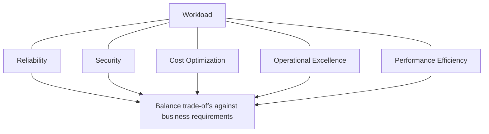

# Module 1: Microsoft Azure Well-Architected Framework — introduction
Units: Introduction · Framework overview (pillars) · Workload and design principles · Trade-offs · Well-Architected Review and tools · Knowledge check · Summary

## Key ideas
- A **workload** = the set of application resources, data and supporting infrastructure that deliver a business outcome.
- Each pillar provides: **design principles**, a **design review checklist**, **trade-offs**, **recommendations** and **patterns**.
- Built on the **shared responsibility model**: the more PaaS/SaaS you use, the more Microsoft handles.

## Pillar summary
| Pillar | One-line goal | Typical questions |
|---|---|---|
| Reliability | Resilient and recovers to a fully working state | What are your RTO/RPO? What fails if a zone goes down? |
| Security | Protect confidentiality, integrity, availability | Who can access what? Is data encrypted? |
| Cost Optimization | Maximise value within budget | Are resources right-sized? Who owns the spend? |
| Operational Excellence | Deploy and operate with confidence | Is everything automated, monitored, and repeatable? |
| Performance Efficiency | Scale efficiently with demand | What happens under 10× load? |

## Tools
| Tool | Use |
|---|---|
| **Azure Well-Architected Review** | Self-assessment that produces a score and recommendations |
| **Azure Advisor** | Recommendations for deployed resources by pillar; **Advisor Score** |
| **WAF service guides** | Per-service guidance (for example AKS, App Service, SQL) |
| **Azure Architecture Center** | Reference architectures, design patterns |
| **Azure Proactive Resiliency Library / Workbooks** | Resiliency checks |

## Trade-off examples
| Improving… | May hurt… |
|---|---|
| Reliability (multi-region) | Cost, operational complexity |
| Security (inspection, encryption) | Performance, cost |
| Cost (fewer instances) | Reliability, performance |
| Performance (overprovisioning, caching) | Cost |

## Self-check
1. Which tool scores existing deployed resources by WAF pillar? → **Azure Advisor**
2. What is a "workload"? → **Resources, data and infrastructure that together deliver a business outcome**
