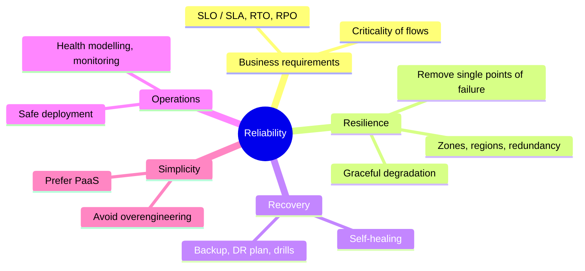

# Module 2: Reliability
Units: Introduction · Design for business requirements · Design for resilience · Design for recovery · Design for operations · Keep it simple · Knowledge check · Summary

## Design principles

| Principle | What to do | Azure examples |
|---|---|---|
| **Design for business requirements** | Define availability targets (SLO), RTO/RPO, critical user flows; calculate composite SLAs | Composite SLA math, failure mode analysis (FMA) |
| **Design for resilience** | Remove single points of failure; handle transient faults; isolate failures | Availability zones, multi-region, load balancers, **retry** (exponential backoff), **circuit breaker**, **bulkhead**, queue-based load levelling, throttling |
| **Design for recovery** | Plan and **test** backups and DR; automate failover | Azure Backup, Site Recovery, geo-replication, chaos engineering with **Azure Chaos Studio** |
| **Design for operations** | Observe health, detect failures early | Azure Monitor, health probes, health endpoint monitoring pattern, Service/Resource Health alerts |
| **Keep it simple** | Fewer moving parts, managed services | PaaS, avoid needless components |

## Key reliability patterns
| Pattern | Purpose |
|---|---|
| Retry | Recover from transient failures |
| Circuit breaker | Stop calling a failing dependency |
| Bulkhead | Isolate resources so one failure doesn't sink everything |
| Queue-based load leveling | Smooth spikes with a queue |
| Health endpoint monitoring | Expose `/health` for probes |
| Geode / deployment stamps | Independent regional copies |
| Compensating transaction | Undo steps of a failed distributed operation |

## Self-check
1. App calls an API that sometimes fails for a second → **Retry with exponential backoff**
2. A downstream service is down for minutes; stop hammering it → **Circuit breaker**
3. Validate DR assumptions by injecting faults → **Azure Chaos Studio**
