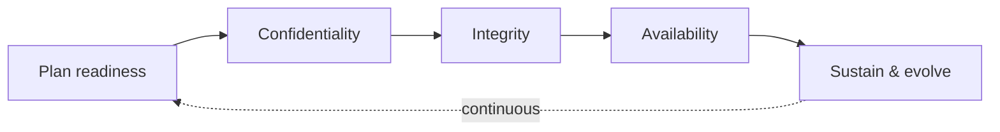

# Module 3: Security
Units: Introduction · Plan your readiness · Design to protect confidentiality · Design to protect integrity · Design to protect availability · Sustain and evolve your security posture · Knowledge check · Summary

| Principle | What to do | Azure examples |
|---|---|---|
| **Plan your readiness** | Adopt Zero Trust, shared responsibility, classify data, threat model, security baselines | Microsoft cloud security benchmark, Defender for Cloud, landing zones |
| **Protect confidentiality** | Least privilege, encryption, prevent data exfiltration | Entra ID, RBAC, PIM, Conditional Access, **managed identities**, **Key Vault**, private endpoints, TDE, Always Encrypted, Purview labels |
| **Protect integrity** | Prevent tampering of data, code and pipelines; verify supply chain | Signed builds, protected branches, IaC review, immutable storage, SQL Ledger, Azure Policy, change tracking |
| **Protect availability** | Withstand attacks such as DDoS and ransomware; contain breaches | **DDoS Protection**, **WAF**, Azure Firewall, NSGs, segmentation, backups with immutable vaults |
| **Sustain and evolve** | Monitor, respond, improve continuously | **Microsoft Sentinel** (SIEM/SOAR), **Defender for Cloud** (Secure Score), incident response plans, pen testing, patching |

## Zero Trust recap
Verify explicitly · least-privilege access (JIT/JEA) · assume breach (segment, encrypt end to end, monitor).

## Network segmentation and identity
- Identity is the **primary perimeter**. Use Entra ID for every user, service and admin access; MFA everywhere; no shared accounts.
- Segment with management groups/subscriptions (governance), VNets/subnets/NSGs (network), and RBAC (identity).

## Self-check
1. App must read secrets without any credentials in code → **Managed identity + Key Vault**
2. Detect and respond to threats across Azure and on-prem with automation → **Microsoft Sentinel**
3. Measure overall security posture with a score → **Defender for Cloud Secure Score**
