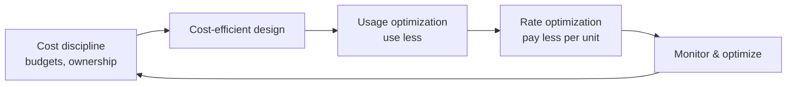

# Module 4: Cost Optimization
Units: Introduction · Develop cost-management discipline · Design with a cost-efficiency mindset · Design for usage optimization · Design for rate optimization · Monitor and optimize over time · Knowledge check · Summary

| Principle | What to do | Azure examples |
|---|---|---|
| **Develop cost-management discipline** | Budgets, cost ownership, **tags** for accountability, forecasting, FinOps | **Microsoft Cost Management** (cost analysis, budgets + alerts, exports), Azure Policy for tags/allowed SKUs |
| **Design with a cost-efficiency mindset** | Estimate before building; choose the right service and tier; measure cost per unit of business | **Pricing calculator**, **TCO calculator**, PaaS/serverless, dev/test pricing |
| **Design for usage optimization** | Pay only for what you use; scale to demand; remove waste | **Autoscale**, right-sizing (Advisor), **auto-shutdown** dev VMs, serverless/consumption plans, storage **lifecycle tiers**, delete orphaned disks/IPs |
| **Design for rate optimization** | Get lower prices for steady usage | **Azure Reservations** (1/3 years, up to ~72% off), **Azure savings plan for compute**, **Spot VMs**, **Azure Hybrid Benefit** (Windows Server/SQL licences), Dev/Test subscriptions, EA/MCA discounts |
| **Monitor and optimize over time** | Review spending regularly, act on anomalies | Cost anomaly alerts, Advisor cost recommendations, regular reviews |

## Pricing quick facts
- **Reservations**: specific resource type, region and size family; best for steady 24×7 workloads.
- **Savings plan**: hourly spend commitment, flexible across VM families/regions.
- **Spot**: unused capacity at deep discount; can be **evicted** — only for interruptible work.
- **Hybrid Benefit**: reuse on-prem licences with Software Assurance.
- **Data egress** costs money (ingress is free); keep chatty services in the same region.

## Self-check
1. Steady 24×7 VMs for 3 years, lowest price → **Reserved Instances (3-year)** (+ Hybrid Benefit if licensed)
2. Alert when monthly spend reaches 80% → **Cost Management budget**
3. Batch work that can be interrupted → **Spot VMs**
