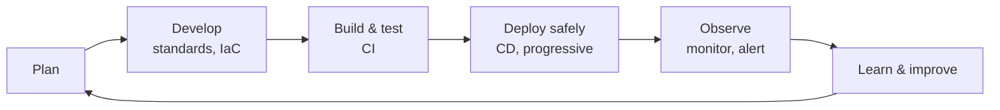

# Module 5: Operational Excellence
Units: Introduction · Embrace DevOps culture · Establish development standards · Evolve operations with observability · Deploy with confidence · Automate for efficiency · Adopt safe deployment practices · Knowledge check · Summary

| Principle | What to do | Azure examples |
|---|---|---|
| **Embrace DevOps culture** | Shared ownership, blameless post-mortems, continuous learning | Azure Boards, GitHub, retrospectives |
| **Establish development standards** | Coding standards, version control, code reviews, testing strategy | Git branching, pull requests, unit/integration tests |
| **Evolve operations with observability** | Instrument everything; logs, metrics, traces; actionable alerts | **Azure Monitor**, **Application Insights**, Log Analytics, Workbooks |
| **Deploy with confidence** | Everything in **Infrastructure as Code**; repeatable, versioned | **Bicep/ARM**, Terraform, **Azure Pipelines**, **GitHub Actions** |
| **Automate for efficiency** | Automate repetitive tasks, remediation and scaling | **Azure Automation** runbooks, Logic Apps, Azure Policy remediation, autoscale |
| **Adopt safe deployment practices** | Small, frequent, progressive releases with quick rollback | **Deployment slots**, blue-green, **canary**, ring-based rollout, **feature flags (App Configuration)**, health-gated releases |

## Key terms
- **Immutable infrastructure**: replace instead of patching in place.
- **Idempotent deployments**: running the same template twice gives the same result (ARM/Bicep incremental mode).
- **Shift left**: test and secure early in the pipeline.

## Self-check
1. Repeatable environment deployments → **IaC (Bicep/ARM/Terraform)**
2. Release a feature to 5% of users first → **Canary / feature flags**
3. End-to-end tracing of requests in a web app → **Application Insights**
