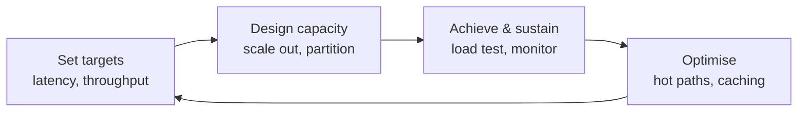

# Module 6: Performance Efficiency
Units: Introduction · Negotiate realistic performance targets · Design to meet capacity requirements · Achieve and sustain performance · Improve efficiency through optimization · Knowledge check · Summary

| Principle | What to do | Azure examples |
|---|---|---|
| **Negotiate realistic performance targets** | Define measurable targets (response time, throughput, concurrency) per critical flow | SLOs, Application Insights baselines |
| **Design to meet capacity requirements** | Choose right services/SKUs; **scale out** (horizontal) over scale up; partition data | VMSS, App Service autoscale, AKS cluster autoscaler/HPA, **Cosmos DB partitioning**, SQL sharding/elastic pools, Hyperscale |
| **Achieve and sustain performance** | **Load test** before release and continuously; monitor performance | **Azure Load Testing**, Azure Monitor, alerts on latency |
| **Improve efficiency through optimization** | Optimise code, data, and network hot paths | **Azure Cache for Redis**, **CDN / Front Door**, async messaging, read replicas, indexing, accelerated networking, proximity placement groups |

## Scale terms
| Term | Meaning |
|---|---|
| **Scale up / vertical** | Bigger instance (more CPU/RAM); may need restart; has a ceiling |
| **Scale out / horizontal** | More instances; needs stateless design; near-limitless |
| **Autoscale** | Automatic scale out/in on metrics or schedule |
| **Partitioning (sharding)** | Split data to spread load |

## Performance patterns
Cache-aside · CQRS (separate read/write models) · Materialized view · Sharding · Queue-based load leveling · Competing consumers · Static content hosting (CDN) · Throttling.

## Self-check
1. Global users see slow static content → **CDN / Front Door caching**
2. Prove the app handles 10,000 concurrent users before launch → **Azure Load Testing**
3. Read-heavy DB is overloaded → **Cache (Redis) and/or read replicas**
