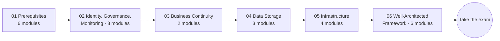

# AZ-305: Designing Microsoft Azure Infrastructure Solutions — Complete Roadmap

Official exam page: https://learn.microsoft.com/en-us/credentials/certifications/exams/az-305/
Passing score: **700/1000** · ~40–60 questions · case studies + multiple choice + drag/drop · ~100 min.

## Exam domains (skills measured as of April 17, 2026)
| Domain | Weight | Folder |
|---|---|---|
| Design identity, governance, and monitoring solutions | 25–30% | [02](02-Design-Identity-Governance-Monitor) |
| Design data storage solutions | 20–25% | [04](04-Design-Data-Storage) |
| Design business continuity solutions | 15–20% | [03](03-Design-Business-Continuity) |
| Design infrastructure solutions | **30–35%** | [05](05-Design-Infrastructure) |

## Study order and checklist
### 01 — [AZ-305 Prerequisites](01-AZ-305-Prerequisites)
- [ ] [01 Core architectural components of Azure](01-AZ-305-Prerequisites/01-Core-Architectural-Components.md)
- [ ] [02 Azure compute services](01-AZ-305-Prerequisites/02-Azure-Compute-Services.md)
- [ ] [03 Azure storage services](01-AZ-305-Prerequisites/03-Azure-Storage-Services.md)
- [ ] [04 Identity, access, and security](01-AZ-305-Prerequisites/04-Identity-Access-Security.md)
- [ ] [05 Cloud Adoption Framework](01-AZ-305-Prerequisites/05-Cloud-Adoption-Framework.md)
- [ ] [06 Intro to the Well-Architected Framework](01-AZ-305-Prerequisites/06-Well-Architected-Framework-Intro.md)

### 02 — [Design identity, governance, and monitor solutions](02-Design-Identity-Governance-Monitor)
- [ ] [01 Design governance](02-Design-Identity-Governance-Monitor/01-Design-Governance.md)
- [ ] [02 Design authentication and authorization](02-Design-Identity-Governance-Monitor/02-Design-Authentication-Authorization.md)
- [ ] [03 Design logging and monitoring](02-Design-Identity-Governance-Monitor/03-Design-Logging-Monitoring.md)

### 03 — [Design business continuity solutions](03-Design-Business-Continuity)
- [ ] [01 Design backup and disaster recovery](03-Design-Business-Continuity/01-Design-Backup-Disaster-Recovery.md)
- [ ] [02 Design for high availability](03-Design-Business-Continuity/02-Design-High-Availability.md)

### 04 — [Design data storage solutions](04-Design-Data-Storage)
- [ ] [01 Non-relational data](04-Design-Data-Storage/01-Non-Relational-Data.md)
- [ ] [02 Relational data](04-Design-Data-Storage/02-Relational-Data.md)
- [ ] [03 Data integration](04-Design-Data-Storage/03-Data-Integration.md)

### 05 — [Design infrastructure solutions](05-Design-Infrastructure)
- [ ] [01 Compute solutions](05-Design-Infrastructure/01-Compute-Solutions.md)
- [ ] [02 Application architecture](05-Design-Infrastructure/02-Application-Architecture.md)
- [ ] [03 Network solutions](05-Design-Infrastructure/03-Network-Solutions.md)
- [ ] [04 Migrations](05-Design-Infrastructure/04-Migrations.md)

### 06 — [Build great solutions with the Well-Architected Framework](06-Well-Architected-Framework)
- [ ] [01 WAF introduction](06-Well-Architected-Framework/01-WAF-Introduction.md)
- [ ] [02 Reliability](06-Well-Architected-Framework/02-Reliability.md)
- [ ] [03 Security](06-Well-Architected-Framework/03-Security.md)
- [ ] [04 Cost Optimization](06-Well-Architected-Framework/04-Cost-Optimization.md)
- [ ] [05 Operational Excellence](06-Well-Architected-Framework/05-Operational-Excellence.md)
- [ ] [06 Performance Efficiency](06-Well-Architected-Framework/06-Performance-Efficiency.md)

### Final revision
- [ ] [EXAM-CHEATSHEET.md](EXAM-CHEATSHEET.md): "if the requirement says X, choose Y" in one page
- [ ] [qa/](qa/README.md): ~190 scenario questions, 4 exam-style case studies and architect interview questions

## Official images
Official Microsoft Learn diagrams appear inside each module, right under the topic they explain. The images are stored in [`assets/`](assets), in the same folder structure as the modules. [`assets/manifest.tsv`](assets/manifest.tsv) lists each image with its module, unit and caption.

> Images © Microsoft, from [Microsoft Learn](https://learn.microsoft.com/training/). Kept here for personal exam study only.

## How to study each module
1. Read the diagram first, then the tables.
2. Learn every **Exam tip** line; these are the usual traps.
3. Answer the **Self-check** questions without looking. Answers are under each question.
